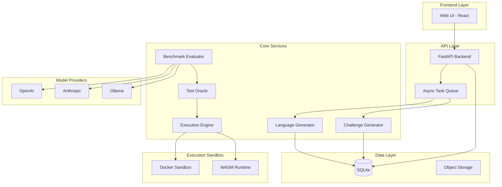
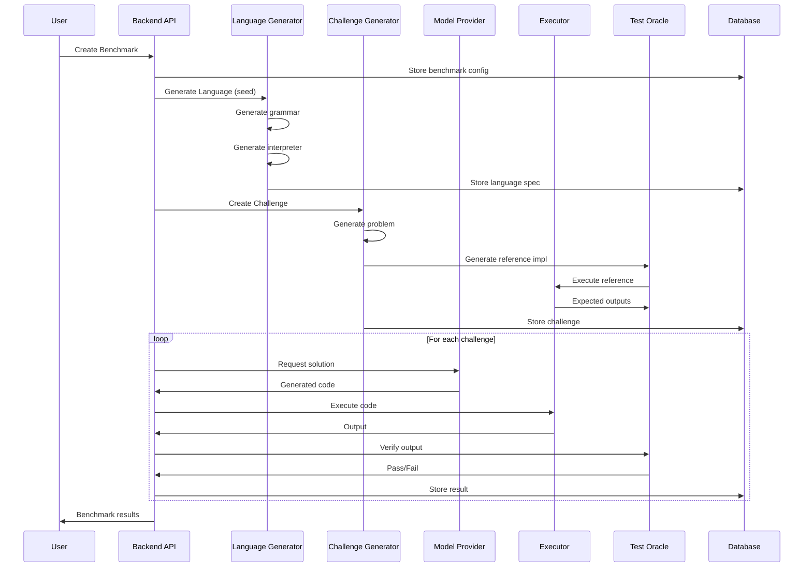

# UnknownLang Technical Design Document

## Overview

UnknownLang is an adaptive AI reasoning benchmark platform that evaluates whether AI models can learn and reason within previously unseen, procedurally generated programming languages. The platform generates controlled programming-language environments, provides specifications to AI models, evaluates their generated programs using independent deterministic interpreters, and measures their ability to generalize beyond provided examples.

### Product Vision
Build a platform that evaluates AI models' ability to learn and reason within previously unseen, procedurally generated programming languages through deterministic execution, independent verification, and standardized benchmarking.

### Target Users (User Personas)
1. **AI Researchers** - Evaluate AI reasoning capabilities, publish benchmark results
2. **Model Developers** - Test model performance on novel language tasks
3. **Academic Evaluators** - Conduct controlled experiments on AI generalization
4. **Hackathon Participants** - Quick-start evaluation demos

### Key Constraints
- Budget: ₹0 (free tier / open source only)
- Development Environment: Kiro IDE
- Target: Kiroween 2026 hackathon
- No paid APIs, hosting, databases or services
- Open-source technologies preferred
- MVP achievable within hackathon timeline
- Modular architecture without premature microservices

### Research Context

**Verified Benchmarks:**
| Benchmark | Source | Languages Used | Overlap with UnknownLang |
|-----------|--------|----------------|--------------------------|
| EsoLang-Bench | arXiv:2603.09678 (submitted March 10, 2026) | 5 esoteric languages (Brainfuck, Befunge-98, Whitespace, Unlambda, Shakespeare) | Similar goal but uses pre-existing esolangs |
| DSL-Bench | arXiv:2611.05168 (submitted November 3, 2026) | 18 domain-specific languages | Similar goal but uses existing DSLs |
| HumanEval, MBPP, APPS, CodeXGLUE | Various | Python, JavaScript, etc. | Standard code benchmarks |

**Key Differentiation:**
UnknownLang's unique value is **procedural language generation** — creating entirely new, never-before-seen programming languages rather than using existing esolangs or DSLs. This enables:
- Systematic measurement of language complexity impact on LLM reasoning
- Truly hidden test cases generated fresh, not from existing problem sets
- Deterministic reproducibility via seeded generation

**What UnknownLang Does NOT Claim:**
- Not the "first" benchmark for evaluating LLMs on unfamiliar languages (EsoLang-Bench, arXiv:2603.09678, March 2026 precedes this)
- Not claiming to test "learning from documentation" uniquely (EsoLang-Bench does this)
- Not a replacement for standard code benchmarks (HumanEval, MBPP, etc.)

**Related Research (Not Competitors):**
- HYSYNTH (arXiv:2405.15880, NeurIPS 2024): A hybrid program synthesis technique that uses LLMs to guide bottom-up synthesis. Different purpose — UnknownLang evaluates LLM reasoning, not synthesis guidance.

---

## Architecture

### System Architecture Overview



### Component Interactions



### Design Decisions

| Decision | Rationale |
|----------|-----------|
| Lark for parsing | Open-source, supports context-free grammars, Python-native |
| SQLite for MVP | Zero cost, simple, adequate for single-instance deployment |
| Docker sandbox | Strong isolation, familiar to hackathon participants |
| FastAPI | Python-native, async support, automatic OpenAPI docs |
| Adapter pattern for models | Easy to add new providers without core changes |

---

## Components and Interfaces

### Language Generator

**Responsibilities:**
- Generate reproducible language specifications from seeds
- Produce validated Lark grammar files
- Map language semantics to interpreter operations
- Ensure syntactic uniqueness

**Public Interface:**
```python
class LanguageGenerator:
    def generate(seed: LanguageSeed, version: str = "1.0.0") -> LanguageSpec:
        """Generate language specification from seed"""
        # Seed is canonicalized (sorted keys, no timestamps)
        # language_id = SHA256(canonical_seed + spec_version + algorithm_version)
        
    def validate_grammar(grammar: str) -> bool:
        """Validate grammar produces valid parse trees"""
        
    def detect_conflicts(spec: LanguageSpec) -> list[Conflict]:
        """Check for conflicts with existing languages"""
```

**Deterministic Identity Algorithm:**
```
LanguageSeed (input)
    │
    ▼
┌─────────────────────┐
│  Canonicalization   │  → Sort dict keys, strip timestamps
└─────────────────────┘
    │
    ▼
┌─────────────────────┐
│  Identity Hash      │  → SHA256(canonical_seed + spec_version + algo_version)
└─────────────────────┘
    │
    ▼
┌─────────────────────┐
│  Grammar Builder    │  → Builds CFG from seed parameters
│  - Terminals        │
│  - Productions      │
│  - Start symbol     │
└─────────────────────┘
    │
    ▼
┌─────────────────────┐
│  Lark Serializer    │  → Outputs Lark-compatible grammar
└─────────────────────┘
    │
    ▼
┌─────────────────────┐
│  Semantic Mapping   │  → Maps syntax to interpreter operations
└─────────────────────┘
    │
    ▼
LanguageSpec (output)
    │
    ▼
generated_at (metadata only, NOT in hash)
```

### Semantic Variation Dimensions

Language generation must produce **genuine semantic variation**, not just syntactic renaming. The MVP supports TWO configurable semantic dimensions:

**a. Arithmetic Semantics**
- Three mode options: `wraparound`, `saturating`, `error-on-overflow`
- Each mode defines how integer arithmetic operations handle overflow and edge cases

**b. Boolean Evaluation Semantics**
- Two evaluation modes: `short_circuit` (lazy) and `eager` (strict)
- Controls whether boolean operators evaluate both operands or short-circuit

**Deferred Semantic Dimensions (Post-MVP):**

**Deferred Semantic Dimensions (Post-MVP):**
| Dimension | Options | Status |
|-----------|---------|--------|
| `evaluation_order` | `left-to-right`, `right-to-left` | ❌ Deferred |
| `type_coercion` | `strict`, `loose` | ❌ Deferred |
| `scoping` | `lexical`, `dynamic` | ❌ Deferred |
| `function_call` | `eager`, `lazy` | ❌ Deferred |

**Semantic Validation (Seed Validation Phase):**

When a LanguageSeed is provided:
1. Validate that requested `arithmetic` is one of: `wraparound`, `saturating`, `error-on-overflow`
2. Validate that requested `short_circuit` is one of: `true`, `false`
3. REJECT with ValidationError if any other semantic dimension is requested
4. REJECT with ValidationError if unsupported combinations are requested

```python
SUPPORTED_SEMANTICS = {
    "arithmetic": {"wraparound", "saturating", "error-on-overflow"},
    "short_circuit": {True, False},
}

def validate_semantic_config(semantics: dict) -> None:
    """Validate semantic configuration; raise ValidationError if unsupported."""
    for key, value in semantics.items():
        if key not in SUPPORTED_SEMANTICS:
            raise ValidationError(f"Unsupported semantic dimension: {key}")
        if value not in SUPPORTED_SEMANTICS[key]:
            raise ValidationError(f"Unsupported value {value} for {key}")
```

**How Semantic Mapping Works:**
```python
# Semantic operations are implemented as pure functions, NOT lambdas:
def integer_add_wraparound(a: int, b: int) -> int:
    """Integer addition with 2's complement wraparound."""
    return (a + b) & 0xFFFFFFFFFFFFFFFF

def integer_add_saturating(a: int, b: int) -> int:
    """Integer addition with saturation at INT64 bounds."""
    MIN_INT = -9223372036854775808
    MAX_INT = 9223372036854775807
    result = a + b
    return max(MIN_INT, min(MAX_INT, result))

def integer_add_error_overflow(a: int, b: int) -> int:
    """Integer addition that raises on overflow."""
    result = a + b
    if result > MAX_INT or result < MIN_INT:
        raise OverflowError(f"Integer overflow: {a} + {b}")
    return result
```

**Constraints:**
- Only include dimensions with formal mathematical definitions
- Each variant must have independent test cases verifiable by reference evaluator
- Semantic differences must be detectable via program behavior
- Unsupported semantic requests MUST be rejected, NOT silently defaulted

### Challenge Generator

**Responsibilities:**
- Select problem templates by type
- Scale complexity by difficulty
- Generate public examples and hidden test cases
- Create reference implementations

**Problem Types:**
1. Array operations (map, filter, reduce)
2. String manipulation (reverse, concat, substring)
3. Recursion (factorial, fibonacci, tree traversal)
4. Sorting (bubble, selection, quick)
5. Search (linear, binary)

**Difficulty Dimensions (Separate from Language Difficulty):**

The platform distinguishes between:
- **Language Difficulty**: Complexity of the generated language's syntax and semantics (controlled by seed features)
- **Challenge Difficulty**: Complexity of the programming task (controlled by problem templates)

**Challenge Difficulty Metrics (1-5):**
| Level | Reasoning Steps | Nesting | State | Control Flow |
|-------|-----------------|---------|-------|--------------|
| 1 | 1-2 | 0-1 | None | Sequential |
| 2 | 3-5 | 1-2 | Simple | Conditionals |
| 3 | 6-10 | 2-3 | Multiple | Loops + conditionals |
| 4 | 11-20 | 3-4 | Complex | Nested loops, recursion |
| 5 | 20+ | 4+ | Rich | Higher-order, optimization |

**Difficulty Mapping:**
- Level 1: Single operation, trivial input (e.g., `add(1, 2)`)
- Level 2: 1-2 nested operations (e.g., `add(mult(2, 3), 1)`)
- Level 3: Multiple functions, conditionals (e.g., factorial with if-zero check)
- Level 4: Complex recursion with state (e.g., fibonacci with memoization pattern)
- Level 5: Multi-step algorithms (e.g., sorting, search with optimization)

### Execution Engine

**Responsibilities:**
- Parse generated language programs using Lark
- Evaluate normalized AST through fixed interpreter
- Apply language-specific semantic mapping
- Enforce resource limits deterministically
- Return typed execution results

**No Generated Interpreter Code**: Instead of generating Python source code, the engine:
1. Generates a declarative LanguageSpec (grammar + semantics)
2. Parses programs into a normalized Lark AST
3. Evaluates the AST using one fixed, trusted interpreter
4. Maps language-specific operations to interpreter operations via semantics config

**Normalized AST Contract:**
- The interpreter operates on Lark's `Tree` objects directly
- No code generation: syntax variations handled via semantic mapping
- All languages share the same evaluator, differing only in grammar and semantics

**Execution Flow:**
```
Source Code
    │
    ▼
┌─────────────────────┐
│  Lark Parser        │  → Build normalized Tree
└─────────────────────┘
    │
    ▼
┌─────────────────────┐
│  Semantic Normalizer│  → Transform to canonical AST
└─────────────────────┘
    │
    ▼
┌─────────────────────┐
│  Fixed Interpreter  │  → Evaluate with resource tracking
│  - Step counter     │
│  - Depth counter    │
│  - Output collector │
└─────────────────────┘
    │
    ▼
ExecutionResult
```

**Resource Limits (Deterministic, Interpreter-Level):**
| Limit | Default | Description |
|-------|---------|-------------|
| `max_steps` | 100,000 | Maximum evaluation steps |
| `max_ast_depth` | 1,000 | Maximum AST node depth |
| `max_call_depth` | 100 | Maximum function call stack |
| `max_collection_size` | 10,000 | Maximum elements in list/dict |
| `max_string_size` | 1MB | Maximum string length |
| `max_output_size` | 1MB | Maximum accumulated output |

**Execution Status Types:**
| Status | Meaning |
|--------|---------|
| `success` | Program completed normally with output |
| `error` | Runtime error (invalid operation, type error) |
| `step_limit_exceeded` | Evaluation steps exceeded max_steps |
| `recursion_limit_exceeded` | Call depth exceeded max_call_depth |
| `output_limit_exceeded` | Output size exceeded max_output_size |
| `ast_depth_exceeded` | AST traversal exceeded max_ast_depth |
| `invalid_program` | Parse failure or semantic error |

**Note**: The interpreter is NOT fully sandboxed. These limits are deterministic checks within the Python process. Full sandboxing requires process-level isolation (Docker/WASM) for security. The interpreter-level limits provide deterministic execution guarantees; process isolation provides security.

### Test Oracle

**Responsibilities:**
- Generate reference implementations independently (NOT using ExecutionEngine)
- Execute via GENUINELY SEPARATE evaluation path
- Cross-validate expected outputs
- Detect and handle disagreements with production interpreter

**Design Principle:** Genuine oracle independence requires that the reference evaluator:
1. Does NOT import the ExecutionEngine module
2. Does NOT call any production interpreter functions
3. Implements formal semantics directly and independently
4. Uses different data structures and evaluation algorithms where practical

---

#### MVP Semantic Dimensions: Formal Definitions

The MVP supports TWO configurable semantic dimensions. Each has formal mathematical definitions used by the independent reference evaluator.

**a. Arithmetic Semantics (MVP: ALL THREE OPTIONS SUPPORTED)**

The MVP supports all three arithmetic modes. Each has complete formal definitions.

**Supported Operations (MVP):**
- `add(a, b)` - Integer addition
- `sub(a, b)` - Integer subtraction
- `mul(a, b)` - Integer multiplication
- `div(a, b)` - Integer division (truncates toward zero)
- `mod(a, b)` - Modulo (remainder sign follows dividend: remainder = a - trunc(a / b) * b)

**Option 1: wraparound (2's complement signed 64-bit)**

```
Given operands a, b and operation op:
1. Compute mathematical result r = a op b
2. Compute unsigned residue: u = r mod 2^64  [Python: r & 0xFFFFFFFFFFFFFFFF]
3. Convert to signed:
   - If u < 2^63: signed_result = u
   - If u >= 2^63: signed_result = u - 2^64  [Python: u - 0x10000000000000000]

Examples:
  add(9223372036854775807, 1) = -9223372036854775808  (wraps from MAX_INT64 to MIN_INT64)
  sub(0, 1) = -1
  mul(2, 3) = 6
  div(-7, 2) = -3  (truncates toward zero)
  mod(-7, 3) = -1  (remainder follows dividend: -7 - (-2) * 3 = -1)
```

**Option 2: saturating**

```
Given operands a, b and operation op:
1. Compute mathematical result r = a op b
2. Clamp to signed 64-bit range:
   - If r > MAX_INT64: result = MAX_INT64
   - If r < MIN_INT64: result = MIN_INT64
   - Otherwise: result = r

Constants: MIN_INT64 = -9223372036854775808, MAX_INT64 = 9223372036854775807
```

**Option 3: error-on-overflow**

```
Given operands a, b and operation op:
1. Compute mathematical result r = a op b
2. If r > MAX_INT64 or r < MIN_INT64: raise OverflowError
3. Otherwise: return r

Division by zero: always raise ZeroDivisionError
Modulo by zero: always raise ZeroDivisionError
```

**Production Interpreter Contract**: Must implement the selected arithmetic semantics exactly as defined above.

**Independent Reference Evaluator Contract**: Must independently implement the same formal definitions using different code. The reference evaluator must derive expected outputs from these mathematical definitions, not from the production interpreter.

**Hand-Verified Baseline Cases (ALL MUST PASS for BOTH evaluators)**:

Constants: MIN_INT64 = -9223372036854775808, MAX_INT64 = 9223372036854775807

| Expression | Mathematical Result | wraparound Result | saturating Result | error-on-overflow |
|------------|--------------------|-------------------|-------------------|-------------------|
| `add(1, 2)` | 3 | 3 | 3 | 3 |
| `add(9223372036854775807, 1)` | 9223372036854775808 | **-9223372036854775808** | MAX_INT64 | OverflowError |
| `add(-1, 1)` | 0 | 0 | 0 | 0 |
| `add(-9223372036854775808, -1)` | -9223372036854775809 | **9223372036854775807** | MIN_INT64 | OverflowError |
| `sub(0, 1)` | -1 | -1 | -1 | -1 |
| `sub(-9223372036854775808, 1)` | -9223372036854775809 | **9223372036854775807** | MIN_INT64 | OverflowError |
| `sub(-9223372036854775808, -1)` | -9223372036854775807 | **-9223372036854775807** | -9223372036854775807 | -9223372036854775807 |
| `mul(1000000, 1000000)` | 1000000000000 | 1000000000000 | 1000000000000 | 1000000000000 |
| `mul(3037000499, 3037000499)` | 9223372030926249001 | 9223372030926249001 | 9223372030926249001 | 9223372030926249001 |
| `mul(3037000500, 3037000500)` | 9223372037000250000 | **-9223372036709301616** | MAX_INT64 | OverflowError |
| `mul(-3037000500, 3037000500)` | -9223372037000250000 | **9223372036709301616** | MIN_INT64 | OverflowError |
| `div(7, 2)` | 3 | 3 | 3 | 3 |
| `div(-7, 2)` | -3.5 → -3 | -3 | -3 | -3 |
| `div(7, -2)` | -3.5 → -3 | -3 | -3 | -3 |
| `div(-7, -2)` | 3.5 → 3 | 3 | 3 | 3 |
| `div(1, 0)` | undefined | ZeroDivisionError | ZeroDivisionError | ZeroDivisionError |
| `div(-9223372036854775808, -1)` | 9223372036854775808 | **-9223372036854775808** (special case) | MAX_INT64 | OverflowError |
| `mod(7, 3)` | 1 | 1 | 1 | 1 |
| `mod(-7, 3)` | -1 | -1 | -1 | -1 |
| `mod(7, -3)` | -2 | -2 | -2 | -2 |
| `mod(-7, -3)` | 2 | 2 | 2 | 2 |
| `mod(1, 0)` | undefined | ZeroDivisionError | ZeroDivisionError | ZeroDivisionError |
| `mod(-9223372036854775808, -1)` | 0 (special case) | 0 | 0 | 0 |

**Note on modulo**: Using truncating-toward-zero division. remainder = dividend - trunc(dividend/divisor) * divisor

**Mathematical Invariants (MUST hold for ALL modes)**:
- `add(x, 0) = x` for all x
- `sub(x, 0) = x` for all x
- `mul(x, 1) = x` for all x
- `mul(x, 0) = 0` for all x
- `div(x, 1) = x` for all x (when x != 0)
- `mod(x, y) = x - y * div(x, y)` (definition)

**Dimension 2: Boolean Semantics (STRICT MODE)**

The MVP uses **strict boolean semantics**: all boolean operations work only with boolean values (`true` and `false`), returning boolean results.

**Configuration:**
- `short_circuit=true` → Short-circuit (lazy) mode
- `short_circuit=false` → Eager mode (both operands always evaluated)

**Boolean Operations - AND:**
```
AND(a, b, short_circuit):
  # a and b MUST be boolean (true or false)
  if short_circuit = true:
    if a = false: return false   # b NOT evaluated
    else: return b               # b evaluated, return b
  else:  # eager
    return a and b               # both evaluated, both must be boolean
```

**Boolean Operations - OR:**
```
OR(a, b, short_circuit):
  # a and b MUST be boolean (true or false)
  if short_circuit = true:
    if a = true: return true     # b NOT evaluated
    else: return b               # b evaluated, return b
  else:  # eager
    return a or b                # both evaluated, both must be boolean
```

**NOT Operation:**
```
NOT(a):
  # a MUST be boolean
  if a = true: return false
  else: return true
```

**Error Handling:**
- If operand is not a boolean (e.g., integer), raise TypeError
- This is strict boolean mode - no truthiness coercion

**Hand-Verified Boolean Cases (STRICT - operands MUST be boolean)**:

Test expressions:
- `error_rt`: runtime error expression (e.g., `1/0` raises ZeroDivisionError)
- `non_bool`: non-boolean value (e.g., `42` raises TypeError when used as boolean)

| Expression | short_circuit=true | short_circuit=false |
|------------|-------------------|---------------------|
| `and(false, error_rt)` | `false` (right NOT evaluated) | ZeroDivisionError (right evaluated first) |
| `or(true, error_rt)` | `true` (right NOT evaluated) | ZeroDivisionError (right evaluated first) |
| `and(true, error_rt)` | ZeroDivisionError (right IS evaluated) | ZeroDivisionError (right evaluated first) |
| `or(false, error_rt)` | ZeroDivisionError (right IS evaluated) | ZeroDivisionError (right evaluated first) |
| `and(false, non_bool)` | `false` (right NOT evaluated, no error) | TypeError (right=42 evaluated, then boolean check fails) |
| `or(true, non_bool)` | `true` (right NOT evaluated, no error) | TypeError (right=42 evaluated, then boolean check fails) |
| `and(true, non_bool)` | TypeError (right IS evaluated → 42, then boolean check) | TypeError |
| `or(false, non_bool)` | TypeError (right IS evaluated → 42, then boolean check) | TypeError |
| `and(false, true)` | `false` | `false` |
| `and(true, true)` | `true` | `true` |
| `and(true, false)` | `false` | `false` |
| `or(false, true)` | `true` | `true` |
| `or(false, false)` | `false` | `false` |
| `or(true, false)` | `true` | `true` |
| `not(true)` | `false` | `false` |
| `not(false)` | `true` | `true` |

**Key distinction**: Under eager evaluation (short_circuit=false), BOTH operands are evaluated BEFORE the boolean operation. Any error in the right operand is raised first. Only after both successfully evaluate to boolean values is the and/or operation performed.

**Invariant Proofs:**
- `and(x, false) = false` for all x ∈ {true, false}
- `or(x, true) = true` for all x ∈ {true, false}
- `not(not(x)) = x` for all x ∈ {true, false}
- `and(x, true) = x` for all x ∈ {true, false}
- `or(x, false) = x` for all x ∈ {true, false}

---

#### Independent Reference Evaluator Architecture

```
┌─────────────────────────────────────────────────────────────┐
│                    INDEPENDENT EVALUATOR                     │
│              (DOES NOT import ExecutionEngine)               │
├─────────────────────────────────────────────────────────────┤
│  ┌─────────────────────────────────────────────────────┐    │
│  │  FormalSemanticsEngine                               │    │
│  │  - Implements arithmetic semantics directly         │    │
│  │  - Implements short-circuit semantics directly      │    │
│  │  - Uses different internal data structures          │    │
│  └─────────────────────────────────────────────────────┘    │
│                            │                                 │
│  ┌─────────────────────────────────────────────────────┐    │
│  │  ReferenceParser                                     │    │
│  │  - May use different parsing strategy               │    │
│  │  - Validates against formal grammar                  │    │
│  └─────────────────────────────────────────────────────┘    │
│                            │                                 │
│  ┌─────────────────────────────────────────────────────┐    │
│  │  ExpectedOutputGenerator                            │    │
│  │  - Runs on reference implementation only            │    │
│  │  - Computes expected outputs independently          │    │
│  └─────────────────────────────────────────────────────┘    │
└─────────────────────────────────────────────────────────────┘
                            │
                            ▼
              ┌───────────────────────────────┐
              │  Cross-Validator               │
              │  1. Run both evaluators        │
              │  2. Compare outputs            │
              │  3. Handle disagreement        │
              └───────────────────────────────┘
```

---

#### Disagreement Handling

When the production interpreter and independent reference evaluator produce different outputs:

| Scenario | Action |
|----------|--------|
| One returns error, other returns value | Mark test case as **INVALID** |
| Both return errors of same type | Mark test case as **INVALID** (semantic mismatch) |
| Both return values but differ | Mark test case as **INVALID** (semantic mismatch) |
| Both return same value | Mark test case as **VERIFIED** |

**Critical**: The benchmark NEVER silently accepts one evaluator's result over the other's. Disagreements indicate a fundamental problem with the language specification or evaluator implementation.

---

#### Independence Guarantees

1. **Separate Implementation**: Reference evaluator is a completely different codebase
2. **Different Templates**: Uses reference-only problem templates, not production templates
3. **Formal Semantics First**: Derives expected outputs from formal definitions, not from running production code
4. **Baseline Verification**: All expected outputs validated against hand-verified cases
5. **Disagreement Detection**: Explicit cross-validation with clear invalidation rules

### Model Provider Abstraction

**Interface:**
```python
class ModelAdapter(ABC):
    @abstractmethod
    def list_models(self) -> list[ModelInfo]:
        """List available models"""
        
    @abstractmethod
    def generate(self, prompt: str, model: str) -> GenerationResponse:
        """Generate code from prompt"""
        
    @abstractmethod
    def estimate_tokens(self, text: str) -> int:
        """Estimate token count"""
```

**Implementations:**
1. **OpenAIAdapter** - OpenAI API (GPT-4, GPT-3.5)
2. **AnthropicAdapter** - Anthropic API (Claude)
3. **OllamaAdapter** - Local Ollama server

### Benchmark Evaluator

**Responsibilities:**
- Orchestrate full evaluation workflow
- Compute scores and metrics
- Aggregate results

**Metrics:**
- **Pass Rate**: `passed / total`
- **Generalization Gap**: `public_score - hidden_score`
- **Weighted Score**: `Σ(score_i × weight_i) / Σ(weight_i)`

---

## Data Models

### Language Specification

```json
{
  "version": "1.0.0",
  "algorithm_version": "1.0.0",
  "language_id": "lang_abc123",
  "seed": {
    "name": "NovaLang",
    "syntax_style": "lisp",
    "features": ["recursion", "functions"],
    "difficulty": 3
  },
  "grammar": {
    "start": "program",
    "rules": [
      "program: expr+",
      "expr: atom | list",
      "list: \"(\" expr*\")\"",
      "atom: NUMBER | STRING | IDENTIFIER"
    ],
    "terminals": {
      "NUMBER": "[0-9]+",
      "STRING": "\"[^\"]*\"",
      "IDENTIFIER": "[a-zA-Z][a-zA-Z0-9]*"
    }
  },
  "semantics": {
    "evaluation_order": "left-to-right",
    "scoping": "lexical",
    "arithmetic": "wraparound",
    "type_coercion": "strict"
  },
  "builtins": [
    {"name": "add", "args": ["int", "int"], "returns": "int", "semantics": "integer_addition"},
    {"name": "sub", "args": ["int", "int"], "returns": "int", "semantics": "integer_subtraction"},
    {"name": "eq", "args": ["any", "any"], "returns": "bool", "semantics": "value_equality"}
  ],
  "resource_limits": {
    "max_steps": 100000,
    "max_ast_depth": 1000,
    "max_call_depth": 100,
    "max_collection_size": 10000,
    "max_string_size": 1048576,
    "max_output_size": 1048576
  },
  "examples": [
    "(add 1 2)",
    "(if (eq 1 1) 10 20)"
  ],
  "generated_at": "2026-01-15T10:30:00Z"
}
```

**Identity Hash Calculation:**
```python
def compute_language_id(seed: LanguageSeed, spec_version: str, algo_version: str) -> str:
    """Compute deterministic language identity (excludes generated_at)."""
    canonical = json.dumps(seed, sort_keys=True)  # Sorted keys for determinism
    payload = f"{canonical}|{spec_version}|{algo_version}"
    return "lang_" + hashlib.sha256(payload.encode()).hexdigest()[:12]
```

### Challenge Structure

```json
{
  "challenge_id": "chal_xyz789",
  "language_id": "lang_abc123",
  "problem_type": "recursion",
  "difficulty": 3,
  "description": "Write a function that computes factorial",
  "function_signature": "def factorial(n)",
  "examples": [
    {"input": [5], "output": 120},
    {"input": [0], "output": 1}
  ],
  "public_tests": [
    {"input": [3], "output": 6},
    {"input": [10], "output": 3628800}
  ],
  "hidden_tests": [
    {"input": [7], "output": 5040},
    {"input": [12], "output": 479001600}
  ],
  "reference_implementation": "(def factorial n (if (eq n 0) 1 (* n (factorial (sub n 1)))))"
}
```

### Database Schema (SQLite)

**Note**: Database implementation is deferred to post-MVP. This schema is for future reference only.

```sql
-- Languages table (future)
CREATE TABLE languages (
    id TEXT PRIMARY KEY,
    seed_data TEXT NOT NULL,
    version TEXT NOT NULL,
    algorithm_version TEXT NOT NULL,
    specification TEXT NOT NULL,  -- Full LanguageSpec JSON
    grammar TEXT NOT NULL,         -- Lark grammar string
    semantics_config TEXT NOT NULL,-- Semantic dimension settings
    resource_limits TEXT NOT NULL, -- Resource limit configuration
    difficulty INTEGER NOT NULL,
    created_at TIMESTAMP DEFAULT CURRENT_TIMESTAMP
);

-- Challenges table
CREATE TABLE challenges (
    id TEXT PRIMARY KEY,
    language_id TEXT NOT NULL,
    problem_type TEXT NOT NULL,
    difficulty INTEGER NOT NULL,
    description TEXT NOT NULL,
    function_signature TEXT,
    examples TEXT NOT NULL,
    public_tests TEXT NOT NULL,
    hidden_tests TEXT NOT NULL,
    reference_implementation TEXT NOT NULL,
    created_at TIMESTAMP DEFAULT CURRENT_TIMESTAMP,
    FOREIGN KEY (language_id) REFERENCES languages(id)
);

-- Benchmark runs table
CREATE TABLE benchmark_runs (
    id TEXT PRIMARY KEY,
    model_provider TEXT NOT NULL,
    model_name TEXT NOT NULL,
    status TEXT NOT NULL,
    config TEXT NOT NULL,
    started_at TIMESTAMP,
    completed_at TIMESTAMP,
    created_at TIMESTAMP DEFAULT CURRENT_TIMESTAMP
);

-- Results table
CREATE TABLE results (
    id TEXT PRIMARY KEY,
    benchmark_run_id TEXT NOT NULL,
    challenge_id TEXT NOT NULL,
    model_response TEXT,
    execution_output TEXT,
    execution_time_ms INTEGER,
    passed BOOLEAN,
    test_results TEXT,
    created_at TIMESTAMP DEFAULT CURRENT_TIMESTAMP,
    FOREIGN KEY (benchmark_run_id) REFERENCES benchmark_runs(id),
    FOREIGN KEY (challenge_id) REFERENCES challenges(id)
);
```

---

## Correctness Properties

*A property is a characteristic or behavior that should hold true across all valid executions of a system-essentially, a formal statement about what the system should do. Properties serve as the bridge between human-readable specifications and machine-verifiable correctness guarantees.*

### Property 1: Language Generation Determinism

*For any* language seed with identical parameters and version, the language generator SHALL produce language specifications with identical language_id, where the identity is computed as SHA256(canonical_seed + spec_version + algorithm_version) WITHOUT generated_at timestamp.

**Validates: Requirements 5.2, 5.7, 6.7**

### Property 2: Grammar Validity

*For any* generated grammar in Lark format, parsing the grammar with Lark SHALL NOT produce parse errors.

**Validates: Requirements 5.2, 7.1**

### Property 3: Interpreter Execution Determinism

*For any* valid program in a generated language, executing the same program with the same input SHALL always produce the same output, regardless of execution environment or timing.

**Validates: Requirements 3.4, 7.4, 20.1**

### Property 4: Test Oracle Independence

*For any* challenge, the test oracle SHALL generate expected outputs that match the reference implementation's outputs, where the reference evaluator uses a SEPARATE evaluation code path from the production ExecutionEngine, including different template selection, independent validation against mathematical invariants, and cross-check verification.

**Validates: Requirements 8.1, 8.2, 8.3, 8.4**

### Property 5: Challenge Uniqueness

*For any* generated challenge, the hidden test cases SHALL differ from the public examples, and all test cases SHALL have deterministic expected outputs verified by the reference implementation.

**Validates: Requirements 9.4, 9.5, 20.4**

### Property 6: Scoring Correctness

*For any* set of benchmark results with known pass/fail status, the computed pass rate SHALL equal (passed test cases / total test cases), and the generalization gap SHALL equal (public_score - hidden_score).

**Validates: Requirements 10.2, 10.3, 10.4**

### Property 7: Reproducibility via Seeds

*For any* language generation with a recorded seed, regenerating with the same seed SHALL produce identical language specifications, ensuring reproducibility of benchmark results.

**Validates: Requirements 4.3, 20.2, 20.3**

### Property 8: Resource Limit Handling

*For any* program execution exceeding interpreter-level resource limits (max_steps, max_ast_depth, max_call_depth, max_output_size), the executor SHALL return a typed inconclusive status (step_limit_exceeded, recursion_limit_exceeded, output_limit_exceeded, ast_depth_exceeded) rather than a failed or incorrect result.

**Validates: Requirements 7.6, 20.8, 20.10**

### Property 9: Semantic Variation Testability

*For any* generated language with semantic variation, the system SHALL include test cases that detect the configured semantic behavior (e.g., short_circuit=false for AND should always evaluate both operands).

**Validates: Requirement 5.6**

---

## Error Handling

### Error Categories

| Category | Description | Response |
|----------|-------------|----------|
| VALIDATION_ERROR | Invalid input format | 400 Bad Request |
| LANGUAGE_ERROR | Grammar/parse failure | 422 Unprocessable Entity |
| EXECUTION_ERROR | Runtime error in program | Result with error details |
| TIMEOUT_ERROR | Execution exceeded limit | Inconclusive status |
| MEMORY_ERROR | Memory limit exceeded | Inconclusive status |
| PROVIDER_ERROR | Model API failure | 503 Service Unavailable |
| DATABASE_ERROR | Storage failure | 500 Internal Server Error |

### Error Response Format

```json
{
  "error": {
    "code": "VALIDATION_ERROR",
    "message": "Invalid language seed: missing required field 'syntax_style'",
    "details": {
      "field": "seed.syntax_style",
      "reason": "required field missing"
    }
  }
}
```

### Execution Result Contract

The interpreter returns a typed ExecutionResult with one of the following statuses:

| Status | When Produced | Includes |
|--------|--------------|----------|
| `success` | Program completed normally with output | output, execution_time_ms |
| `runtime_error` | Invalid operation, type error, division by zero | error_message, execution_time_ms |
| `instruction_limit_exceeded` | Evaluation steps exceeded max_steps | output (partial), execution_time_ms |
| `recursion_limit_exceeded` | Call depth exceeded max_call_depth | output (partial), execution_time_ms |
| `ast_depth_exceeded` | AST traversal exceeded max_ast_depth | output (partial), execution_time_ms |
| `output_limit_exceeded` | Output size exceeded max_output_size | output (truncated), execution_time_ms |
| `invalid_program` | Parse failure or grammar error | error_message |

```python
@dataclass
class ExecutionResult:
    status: Literal["success", "runtime_error", "instruction_limit_exceeded", 
                     "recursion_limit_exceeded", "ast_depth_exceeded", 
                     "output_limit_exceeded", "invalid_program"]
    output: str | None = None
    error_message: str | None = None
    execution_time_ms: int = 0
    steps_executed: int = 0
    ast_depth_reached: int = 0
```

---

## Testing Strategy

### Testing Philosophy

This platform involves a hybrid testing approach:
- **Unit tests** for pure functions (scoring, validation)
- **Property-based tests** for language generation and execution
- **Integration tests** for API endpoints and database
- **Example-based tests** for adapter interfaces

### Unit Testing (for pure functions)

**Focus Areas:**
- Score calculations (pass rate, generalization gap, weighted score)
- Input validation functions
- Data transformation utilities
- Configuration parsing

**Tools:** pytest

### Property-Based Testing (for core logic)

**Focus Areas:**
- Language generation determinism
- Grammar validity with Lark
- Interpreter execution consistency
- Challenge generation uniqueness

**Tools:** Hypothesis (Python PBT library)

**Configuration:**
- Minimum 100 iterations per property
- Reference format: `Feature: unknownlang, Property N: <property_text>`

### Integration Testing

**Focus Areas:**
- API endpoints (FastAPI TestClient)
- Database operations
- Model adapter integration
- Sandbox execution

**Tools:** pytest, pytest-asyncio

### Test Coverage Target

| Component | Target Coverage |
|-----------|-----------------|
| Language Generator | 80% |
| Challenge Generator | 80% |
| Execution Engine | 85% |
| Benchmark Evaluator | 80% |
| API Endpoints | 70% |

### Why Property-Based Testing Applies Here

The UnknownLang platform has several components suitable for PBT:
1. **Language Generator** - Pure function from seed → spec, input variation matters
2. **Interpreter** - Pure execution with deterministic output
3. **Challenge Generator** - Produces structured data with controllable variation

Infrastructure components (API, database, sandbox) use integration tests instead.

---

## 8. API Design

### 8.1 REST Endpoints

| Method | Endpoint | Description |
|--------|----------|-------------|
| POST | /languages | Generate new language |
| GET | /languages/{id} | Get language specification |
| GET | /languages | List languages |
| POST | /challenges | Create challenge |
| GET | /challenges/{id} | Get challenge |
| POST | /benchmarks | Start benchmark run |
| GET | /benchmarks/{id} | Get benchmark status |
| GET | /benchmarks/{id}/results | Get benchmark results |
| GET | /models | List available models |

### 8.2 Async Operations

Long-running operations return a job ID:
```json
{
  "job_id": "job_abc123",
  "status": "pending",
  "created_at": "2026-01-15T10:30:00Z"
}
```

Poll status: `GET /jobs/{job_id}`

### 8.3 OpenAPI Documentation

Auto-generated at `/docs` endpoint using FastAPI's built-in support.

---

## 9. Frontend Architecture

### 9.1 Pages

| Page | Route | Description |
|------|-------|-------------|
| Dashboard | / | Recent benchmarks, quick actions |
| Language Explorer | /languages | Browse generated languages |
| Language Detail | /languages/:id | View language specification |
| Challenge Editor | /challenges/new | Create custom challenge |
| Benchmark Runner | /benchmarks/new | Configure and run benchmark |
| Results Viewer | /results/:id | Detailed results and charts |
| Settings | /settings | API keys, preferences |

### 9.2 User Flows

**Run Benchmark Flow:**
```
Dashboard → Configure Benchmark → Select Language → Select Models → 
Start → Watch Progress → View Results
```

**Explore Language Flow:**
```
Language Explorer → Browse List → View Detail → See Challenges
```

### 9.3 Technology Stack
- React 18+ with TypeScript
- Vite for build tooling
- React Router for navigation
- Recharts for visualization

---

## 10. Security Architecture

### 10.1 Sandbox Isolation

All code execution occurs in isolated environments:

**Docker Sandbox:**
- 5 second CPU timeout
- 128MB memory limit
- 1MB output limit
- No network access
- Ephemeral filesystem

**WASM Alternative:**
- QuickJS runtime for lighter execution
- Similar resource limits

### 10.2 API Key Management

- Keys stored encrypted at rest
- Never logged or exposed in errors
- User-provided keys for their own API calls

### 10.3 Benchmark Leakage Prevention

- Procedural generation ensures no overlap with training data
- Hidden test cases never exposed to models
- Versioned languages for reproducibility

---

## 11. Deployment Architecture

### 11.1 Docker Compose

```yaml
version: '3.8'
services:
  api:
    build: .
    ports:
      - "8000:8000"
    environment:
      - DATABASE_URL=sqlite:///unknownlang.db
      - OLLAMA_BASE_URL=http://ollama:11434
    volumes:
      - ./data:/app/data
    depends_on:
      - db
      
  db:
    image: postgres:15
    environment:
      - POSTGRES_USER=user
      - POSTGRES_PASSWORD=password
      - POSTGRES_DB=unknownlang
    
  sandbox:
    build: ./sandbox
    read_only: true
    mem_limit: 128m
    cpu_quota: 5000
```

### 11.2 Environment Configuration

| Variable | Description | Default |
|----------|-------------|---------|
| DATABASE_URL | SQLite or PostgreSQL connection | sqlite:///unknownlang.db |
| OLLAMA_BASE_URL | Local Ollama server | http://localhost:11434 |
| OPENAI_API_KEY | User's OpenAI key | - |
| ANTHROPIC_API_KEY | User's Anthropic key | - |
| EXECUTION_TIMEOUT_MS | Program timeout | 5000 |
| MEMORY_LIMIT_MB | Memory limit | 128 |

### 11.3 Free Tier Deployment Options

1. **Railway** - Free tier available
2. **Render** - Free tier available
3. **Fly.io** - Free tier available
4. **Local** - Docker Compose for development

---

## 12. Phased Implementation

### Phase 1: MVP (48 hours) — historical draft status, not repository acceptance

The original checklist below is retained as historical planning context. It is **not evidence that the
items were implemented**. Current repository status is recorded in `README.md` and the Wave 2 owner
package.

- [x] Language Generator with seed support — implemented in Wave 1
- [partial] Interpreter Executor with timeout — Wave 1 evaluator exists; process timeout/sandbox does not
- [ ] Challenge Generator with templates — not implemented
- [ ] Basic API with endpoints — not implemented
- [ ] Simple Frontend — not implemented
- [ ] OpenAI Integration — not implemented
- [ ] Demo Flow (live generation → challenge → evaluate) — not implemented

### Phase 2: Post-Hackathon
- [ ] Anthropic and Ollama adapters
- [ ] Result persistence to database
- [ ] Advanced metrics (generalization gap)
- [ ] Benchmark runner for batch evaluation
- [ ] Improved UI with charts

### Phase 3: Future
- [ ] Language registry
- [ ] Challenge library
- [ ] Leaderboards
- [ ] API rate limiting
- [ ] Community features

---

## 13. Demo Plan (Hackathon)

### Live Demo Script

1. **Generate Language** (2 min)
   - Show seed input
   - Display generated grammar
   - Show interpreter code

2. **Create Challenge** (2 min)
   - Select problem type
   - Display examples
   - Show hidden tests (not revealed to model)

3. **Run Evaluation** (3 min)
   - Select 2-3 models (GPT-4, Claude, local)
   - Show parallel execution
   - Display results in real-time

4. **Results Comparison** (2 min)
   - Show pass rates
   - Display generalization gap
   - Highlight interesting failures

5. **Backup Plans**
   - Pre-generated language if live generation fails
   - Cached results if API rate limited
   - Simplified single-model demo if time constrained

---

## 14. Appendix: Technology Assessment

| Technology | Generation | Sandboxing | Rating |
|------------|------------|------------|--------|
| Racket | Y | Y | MEDIUM |
| ANTLR | Y | N | MEDIUM |
| Lark | Y | N | HIGH |
| Trealla | N | Y | MEDIUM |
| WASM | N | Y | HIGH |

**Selected:** Lark for generation, Docker+WASM for sandboxing

---

## 15. Revised Implementation Risks and Limitations

### Known Limitations

1. **Interpreter-Level Limits Are Not Sandboxing**: The interpreter implements deterministic resource limits (max_steps, max_ast_depth, etc.) within the Python process, but does NOT provide security isolation. Untrusted programs can still access the host filesystem, network, and other resources. Full sandboxing requires process-level isolation (Docker containers or WASM runtime).

2. **Shared Bug Risk**: Even though the reference evaluator uses a separate code path, both it and the production interpreter may share latent bugs in common semantic assumptions. Cross-validation helps detect but cannot eliminate this risk.

3. **Semantic Variation Complexity**: Each additional semantic dimension (evaluation_order, arithmetic, type_coercion) multiplies the complexity of testing and verification. The MVP should limit to 2-3 dimensions.

4. **Lark Grammar Ambiguity**: Some generated grammars may have parsing ambiguity that Lark warns about but accepts. These should be validated and rejected during language generation.

### Implementation Risks

| Risk | Likelihood | Impact | Mitigation |
|------|------------|--------|------------|
| Generated grammar has Lark warnings | High | Medium | Add grammar validation step, iterate on seed |
| Reference and production disagree on baseline | Medium | High | Cross-check tests, manual verification |
| Semantic mapping bugs | Medium | High | Property-based tests with known inputs |
| Resource limits too restrictive | Medium | Low | Make configurable, test with edge cases |
| Determinism not preserved in edge cases | Low | High | Hypothesis PBT with many iterations |

### What This Architecture Does NOT Solve

- **Training data contamination**: Procedural generation reduces but does not eliminate this risk
- **LLM memorization of language semantics**: Not addressed by the benchmark
- **Security of untrusted code execution**: Requires separate sandboxing layer
- **Perfect oracle independence**: Practical independence, not mathematical proof

---

## 16. Revised Implementation Task Order

Based on the revised architecture, Wave 1 tasks should be implemented in this order:

### Wave 1A: Foundation and Identity (First)
1. **2.1** Seed hashing with version-aware identity computation
2. **2.2** Grammar builder with semantic dimension configuration
3. **2.3** Lark serializer with validation
4. **2.4** Semantic mapping and operation registry

### Wave 1B: Fixed Interpreter (Second)
5. **3.1** Lark parser integration with normalized AST
6. **3.2** Fixed interpreter with semantic operation lookup
7. **3.3** Deterministic resource limits (steps, depth, output)
8. **3.4** ExecutionResult with typed statuses

### Wave 1C: Challenge & Independent Oracle (Third)
9. **4.1** Problem templates (separate from reference templates)
10. **4.2** Difficulty metrics (reasoning_steps, nesting, state, control_flow)
11. **4.3** Example/test case generation
12. **4.4** Reference implementation generator (independent path)
13. **5.1** Independent reference evaluator
14. **5.2** Cross-validation and invariant checking

### Wave 1D: Testing Throughout
- **2.6** Property tests for deterministic identity
- **3.5** Property tests for interpreter determinism
- **4.6** Property tests for challenge uniqueness
- **5.3** Unit tests for oracle verification

### Parallel Opportunities
- 2.2 and 2.3 can proceed in parallel (grammar building vs serialization)
- 3.1 and 3.2 can proceed in parallel (parser setup vs evaluator logic)
- 4.1 and 4.2 can proceed in parallel (templates vs difficulty metrics)

---

## 17. GO / NO-GO Decision (historical draft status)

This section records the original design decision as historical context. It is not current acceptance
for the repository or Wave 2. Current status is `NEEDS_CHANGES` in `RELEASES.md` and the owner package.

### Original GO criteria

The original checklist remains useful as design rationale, but the following claims require current
repository evidence before they can be marked PASS:

- Language identity must match the approved Wave 2 identity contract, not only the legacy seed hash.
- Oracle independence must state its shared parser/grammar limits.
- Resource limits must include the approved status and sandbox contract.
- Module interfaces must exist in the repository before implementation is claimed.
- Semantic variation must be measured by the approved benchmark factors.

### Current disposition

The Wave 1 language runtime is tested and deterministic within its documented scope. Wave 2 benchmark
architecture is proposed but not implemented. API, frontend, challenge generation, provider adapters,
persistence, scoring and sandbox execution are not complete. Normative amendments remain pending owner
approval.

**Current verdict: NO-GO for Wave 2 implementation and official benchmark execution until the owner
approves the amendment package and the security/runtime gates pass.**