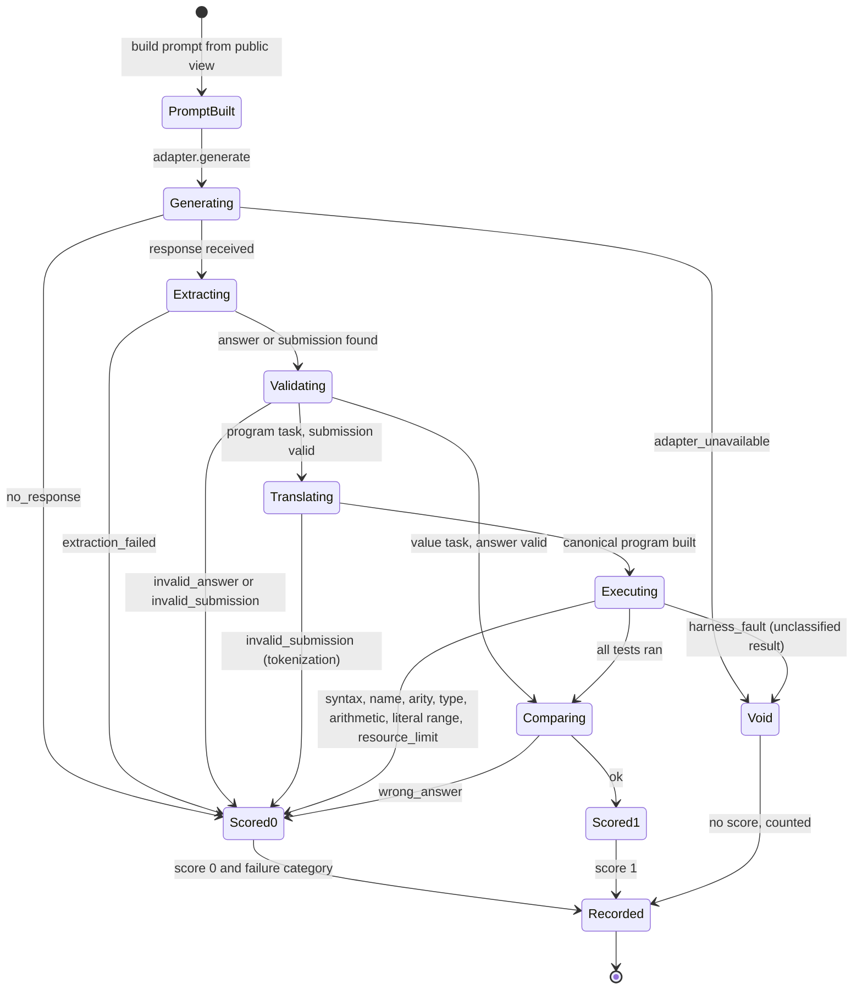
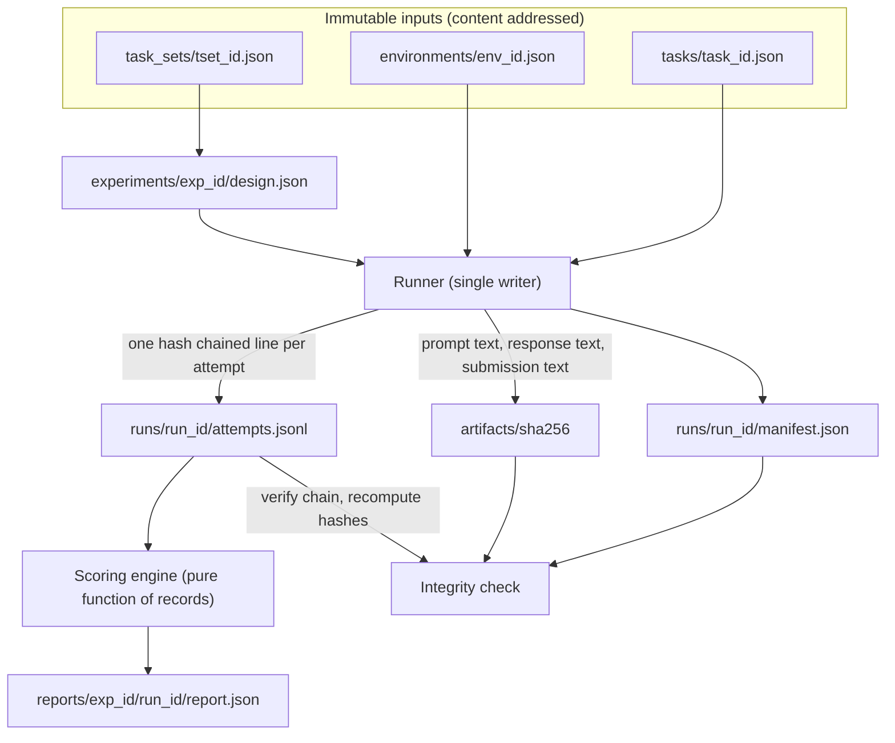
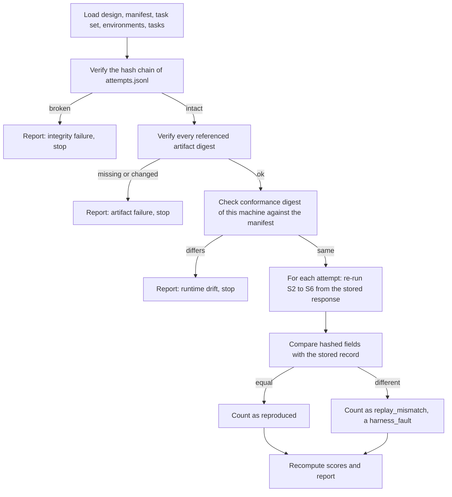

# Experiment Model (Wave 2.0)

Status: **Proposed. Pending review and approval. Nothing here is implemented.**
Baseline: Wave 1C.16.1, commit `642b2c8`.
Identifier forms, enumerations and the canonical JSON rule are defined in the
[task schema](benchmark-task-schema.md). Failure categories and scoring are defined in
[evaluation and scoring](evaluation-and-scoring.md). Neither is redefined here.

## 1. Purpose

An experiment record has one job: let someone else, later, check what was run, what the model said,
what the runtime did with it and how it was scored, **without trusting the person who ran it**, and
rerun the evaluation to the same result.

## 2. Vocabulary and lifecycle

| Term | Meaning | Identity |
|---|---|---|
| **Experiment** | A design: one model configuration on one task set with one prompt template and a sample count | `exp_<sha256 of the design>`: the same design always has the same id |
| **Run** | One execution of an experiment on one machine at one time | `run_<experiment suffix>_<utc>_<n>`: not content hashed; it records a moment |
| **Attempt** | One `(task, sample index)` inside a run | `att_<sha256 of (experiment_id, task_id, sample_index)>`: stable across runs |

Because the attempt id does not depend on the run, the same attempt in two runs can be compared
record by record. That comparison is how determinism is checked (section 8).

### 2.1 Run states

A run is `planned`, then `running`, then one of `complete`, `incomplete` or `aborted`.

* `complete`: every scheduled attempt has a scored record and the integrity checks passed.
* `incomplete`: at least one attempt is `void` or missing. The run can be resumed. A resumed run
  stays the same run and appends records.
* `aborted`: stopped by the operator or by an unrecoverable `harness_fault`. Kept as evidence, never
  deleted, and never ranked.

A run that is not `complete` is never used in a ranking ([evaluation and scoring](evaluation-and-scoring.md),
section 6.5).

## 3. Records

All hashed content follows the canonical JSON rules of the task schema. Fields that vary between
runs of the same attempt live in a `volatile` object, which is excluded from every hash and from
every determinism comparison.

### 3.1 Experiment design (hashed, immutable)

```json
{
  "design_schema_version": 1,
  "task_set_id": "tset_<sha256>",
  "prompt_template": { "id": "prompt.answer", "version": 1 },
  "samples_per_task": 1,
  "runtime_semantics_version": 1,
  "model": {
    "adapter_kind": "mock",
    "adapter_version": "1",
    "model_id": "strategy:constant",
    "model_digest": null,
    "privileged": false,
    "generation_config": {
      "temperature_milli": 0,
      "top_p_milli": 1000,
      "max_output_tokens": 512,
      "seed": 7,
      "stop": []
    }
  }
}
```

The generation config uses integers only (`temperature_milli`, not a float). `model_digest` is the
content digest a local model server reports for the exact model files, where one exists, so that
"the same model name" cannot hide a changed model. `privileged` is true for any adapter that can see
task private data (the oracle and prior agents of the evaluation document, section 10). The runner
refuses a privileged adapter in an official run.

### 3.2 Run manifest

| Field | Notes |
|---|---|
| `run_id`, `experiment_id`, `status` | section 2.1 |
| `counts` | `scheduled`, `scored`, `void`, as integers |
| `environment_attestation.conformance_digest` | digest of the conformance corpus results on this machine ([schema](benchmark-task-schema.md), 11.3). A mismatch against the value recorded for the task set is a hard error |
| `environment_attestation.python_version`, `lark_version` | recorded, not part of any identity |
| `environment_attestation.unknownlang_commit`, `working_tree_clean` | the git commit of the harness. A run from a dirty tree is allowed for development and rejected for an official run |
| `official` | true only if the checks in [evaluation and scoring](evaluation-and-scoring.md), section 9, can hold |
| `volatile.started_at`, `volatile.finished_at`, `volatile.host_os` | not hashed |

The manifest holds no host name, user name, absolute path or environment variable.

### 3.3 Attempt record

One JSON object per line in `attempts.jsonl`.

| Field | Type | Hashed | Notes |
|---|---|---|---|
| `attempt_id`, `experiment_id`, `run_id`, `task_id`, `sample_index` | strings and int | yes, except `run_id` | `run_id` is excluded so that equal attempts in different runs have equal hashes |
| `environment_id` | string | yes | copied from the task, so a record is readable without the task |
| `prompt.template`, `prompt.prompt_sha256` | | yes | the prompt text is an artifact (section 4) |
| `response.response_sha256`, `response.finish_reason` | | yes | `finish_reason` is `stop`, `length` or `error` |
| `response.usage` | `{prompt_tokens, completion_tokens}` or `null` | no | adapter reported, often absent |
| `extraction.status`, `extraction.method`, `extraction.candidates_found` | | yes | `candidates_found` greater than 1 is recorded because only the last candidate counts |
| `submission.submission_sha256` | | yes | the extracted text. The artifact holds the text |
| `execution.tests` | list, empty for `value` tasks | yes | per test: `test_id`, `program_sha256` (digest of the translated canonical program that was run), `status`, `result` (`{kind, value}` or `{kind: "error", error_class}`), `failure_category`, `detail`. A `value` task executes nothing, so its list is empty |
| `execution.limits` | object | yes | the limits applied |
| `evaluation.outcome` | `ok` or `fail` or `void` | yes | |
| `evaluation.score` | integer 0 or 1, or `null` for `void` | yes | |
| `evaluation.failure_category`, `evaluation.detail` | | yes | values from [evaluation and scoring](evaluation-and-scoring.md), section 3.1 |
| `evaluation.diagnostics` | object | yes | integer counts: `public_passed`, `public_total`, `hidden_passed`, `hidden_total`, and `minimal_steps` where measured |
| `integrity.record_sha256` | digest | n/a | digest of the hashed fields above |
| `integrity.prev_sha256` | digest | n/a | the previous line's `record_sha256` (the manifest digest for the first line) |
| `volatile.started_at`, `volatile.latency_ms`, `volatile.wall_ms` | | no | timing. Never compared |

Example structure. Hashes are shown as the placeholder `<sha256>`; this is a layout illustration and
not a real record.

```json
{
  "attempt_id": "att_<sha256>",
  "experiment_id": "exp_<sha256>",
  "task_id": "task_<sha256>",
  "environment_id": "env_<sha256>",
  "sample_index": 0,
  "prompt": { "template": { "id": "prompt.program", "version": 1 }, "prompt_sha256": "<sha256>" },
  "response": { "response_sha256": "<sha256>", "finish_reason": "stop", "usage": null },
  "extraction": { "status": "ok", "method": "last_fenced_block", "candidates_found": 1 },
  "submission": { "submission_sha256": "<sha256>" },
  "execution": {
    "limits": { "max_steps": 100000, "max_ast_depth": 1000, "max_call_depth": 100,
                "max_submission_bytes": 4096, "wall_clock_ms": 2000 },
    "tests": [
      { "test_id": "t1", "program_sha256": "<sha256>", "status": "success",
        "result": { "kind": "int", "value": 0 }, "failure_category": "ok", "detail": null }
    ]
  },
  "evaluation": {
    "outcome": "ok", "score": 1, "failure_category": "ok", "detail": null,
    "diagnostics": { "public_passed": 2, "public_total": 2, "hidden_passed": 3, "hidden_total": 3 }
  },
  "integrity": { "record_sha256": "<sha256>", "prev_sha256": "<sha256>" },
  "volatile": { "started_at": "<timestamp>", "latency_ms": 0, "wall_ms": 0 }
}
```

## 4. Storage

### 4.1 Decision

Plain files. No database, no server, no queue. The reasoning and the conditions for revisiting it
are in [ADR-004](adr/ADR-004-experiment-storage.md).

### 4.2 Layout

The data root is configurable and defaults to a directory that is not tracked by git.

```
<data_root>/
  environments/<env_id>.json
  tasks/<task_id>.json
  task_sets/<tset_id>.json
  artifacts/<sha256>                       prompts, responses, submissions (text, content addressed)
  experiments/<exp_id>/design.json
  experiments/<exp_id>/runs/<run_id>/manifest.json
  experiments/<exp_id>/runs/<run_id>/attempts.jsonl
  reports/<exp_id>/<run_id>/report.json
```

* `environments/`, `tasks/` and `task_sets/` are immutable and content addressed: writing an existing
  id with different content is an error.
* `artifacts/` stores each distinct text once. Prompts repeat across samples and models and are
  deduplicated by their digest.
* Tasks of the **held-out** split, their private fields and the sealed seed list never go into the
  repository. Only dev data and the generators are public.

### 4.3 Writing safely

* `attempts.jsonl` is append only, one writer per run (a lock file), one `fsync` per line.
* Immutable files are written to a temporary name and renamed, so a reader never sees a partial file.
* On resume, a trailing line that is not valid JSON is **moved** to `attempts.jsonl.partial` and
  reported. It is not silently deleted.
* The hash chain makes edits, deletions and reordering **detectable**: changing any line changes its
  `record_sha256` and breaks the next line's `prev_sha256`. It is not signed, so someone with
  write access who recomputes the whole chain can forge a run. Tamper evidence, not tamper proofing.

## 5. Model adapter interface

### 5.1 Design constraints

1. An adapter turns text into text. It never sees a task, an environment object, an expected
   answer, a hidden test or a score.
2. An adapter cannot score. Only the runner creates an attempt record.
3. Adding a provider changes no evaluation code (requirements.md, Requirement 11, criterion 3).
4. The benchmark runs end to end on the deterministic mock adapter, with no network, no key and no
   cost.

### 5.2 Interface

Design only. Not implemented.

```python
class PromptBundle:            # produced by PromptBuilder from the *public view*; frozen
    text: str
    prompt_sha256: str
    template: TemplateRef      # id and version

class GenerationConfig:        # integers only
    temperature_milli: int
    top_p_milli: int
    max_output_tokens: int
    seed: int | None
    stop: tuple[str, ...]

class RawResponse:
    text: str
    finish_reason: str                         # "stop" | "length" | "error"
    usage: Usage | None                        # token counts if the adapter knows them
    latency_ms: int                            # volatile
    error: AdapterError | None                 # a failure is data, not an exception

class ModelAdapter(Protocol):
    kind: str
    version: str
    def describe(self) -> AdapterDescription: ...        # model_id, model_digest, privileged
    def generate(self, prompt: PromptBundle, config: GenerationConfig) -> RawResponse: ...
    def list_models(self) -> list[ModelInfo]: ...        # requirements.md, Requirement 11, criterion 1
    def estimate_tokens(self, text: str) -> int: ...     # requirements.md, Requirement 11, criterion 1
```

* `generate` reports failure through `RawResponse.error`. Any exception that escapes is caught by
  the runner and recorded as `adapter_unavailable` with detail `adapter_error`.
* `list_models` and `estimate_tokens` are kept from requirements.md, Requirement 11, criterion 1. The
  mock adapter implements them trivially.
* An adapter module may import the standard library and its own client code only. It may not import
  `src.execution`, `src.oracle`, `src.language`, `src.challenge` or the harness. An import-boundary
  test enforces this, in the style of the existing independence tests for the reference evaluator.
* No adapter option holds a secret. Provider credentials, if one is ever needed, come from the
  process environment at call time and are never written to a design, manifest or record.

### 5.3 Adapters

| Adapter | Status | Purpose |
|---|---|---|
| `ScriptedAdapter` | M2.7 | Returns stored responses by prompt digest. Used for replay and for tests |
| `StrategyAdapter` | M2.7 | Deterministic agents that read only the prompt text: `constant`, `random(seed)`, `smallint(seed)`, `garbage`, `bomber`, `syntax_only`, `hedger`, `hardcoder` |
| `OracleAdapter`, `PriorAdapter` | M2.7 | **Privileged.** Built with access to task or environment data in order to produce the known answer. Test only. `privileged: true`, rejected in official runs |
| `LocalHttpAdapter` | M2.11, not before approval | A local model server over HTTP on the same machine. No key, no cost. Provider details are deferred |

requirements.md, Requirement 11, criterion 2 says the first implementation is an OpenAI-compatible
API. That conflicts with the zero-cost rule and with the instruction not to assume external
availability. It is recorded as specification delta SD2 in the [overview](wave2-overview.md). A
local server may expose an OpenAI-compatible wire format, so the later local adapter can still
follow the intent of that criterion. That is to be confirmed when the adapter is built.

### 5.4 Why adapters cannot bypass evaluation

| Attack | Why it fails |
|---|---|
| Return the expected answer | The adapter never receives it. The prompt is built from the public view. Privileged adapters are labelled and refused |
| Write a record | The runner is the only code that builds records, and it chains them |
| Return a different type than expected | `RawResponse` is validated by the runner. Anything else is `adapter_unavailable` or `harness_fault` |
| Influence the runtime | The response is text. It is extracted, validated and translated by harness code before the runtime sees a canonical program |
| Emit instructions aimed at the harness | Treated as data: nothing in the harness interprets response text except the extraction patterns |

## 6. Submission lifecycle



Every path ends in exactly one record. There is no path that produces a score without passing the
stages above, and no path that discards a failure.

## 7. Result persistence



The scoring engine reads records and nothing else, so a report can always be regenerated from the
stored records. A report is never an input to anything.

## 8. Deterministic replay

### 8.1 What can be replayed

**Evaluation is deterministic. Model generation is not.** Replay therefore re-runs everything that
follows the model's response and never calls the model again.

| Mode | Re-runs | Needs | Detects |
|---|---|---|---|
| **RP1 Evaluation replay** | S2 to S6 on each stored response | the stored artifacts, the task set, the environments | a change in the harness or runtime since the run, and tampering |
| **RP2 Full pipeline replay** | S0 to S6, with a `ScriptedAdapter` that answers each prompt digest with the stored response | as RP1, plus the prompt builder | a change in prompt building as well |
| **RP3 Regeneration check** | rebuilds every environment and task from the recorded derivation seeds and compares identifiers | the generators and the derivation records | a change in the generators, Python or Lark that alters the tasks |

### 8.2 RP1 algorithm



### 8.3 What is compared

Every field marked as hashed in section 3.3 is compared exactly. The `volatile` object is ignored. A
replay mismatch is a `harness_fault` with detail `replay_mismatch`, and diagnostic D10 counts it. A
run with a nonzero D10 is not official.

### 8.4 Limits of replay

* Replay does not show the model would answer the same again. For a stochastic model it would not.
* Replay depends on the Python and Lark versions only through the conformance digest. If the digest
  matches, behavior on the corpus is the same, which is evidence but not proof for other programs.
* Replay of an old run on newer code is expected to fail whenever `runtime_semantics_version` changed.
  That is the intended behavior. The old run keeps its meaning under the old version.

## 9. Privacy and secrets

* No API key, token, password or provider credential is read, stored or logged by the benchmark in
  this wave. There is no provider that needs one.
* A design stores the adapter kind and model identifier, not an endpoint address.
* Prompts are built from generated, non-personal data. Responses are model text and are stored as
  artifacts with a size cap (`max_response_bytes`, a parameter of the design).
* The manifest records versions and a git commit, never a path, host name or user name.
* Sealed seed lists and salts stay outside the repository, in the data root with restrictive file
  permissions.

## 10. Report model

A report is a pure function of one run's records and manifest (section 7). It is the structure a
future interface, such as a dashboard, would read. No interface is built in Wave 2.

Every ratio is an integer pair `{ "num": n, "den": d }`. A rendered decimal is added only by a
presentation layer. Intervals are pairs of such values.

```json
{
  "report_schema_version": 1,
  "experiment_id": "exp_<sha256>",
  "run_id": "run_...",
  "comparability_key": {
    "task_set_id": "tset_<sha256>",
    "prompt_template": { "id": "prompt.answer", "version": 1 },
    "runtime_semantics_version": 1,
    "family_version": "f1"
  },
  "status": { "run": "complete", "coverage": { "num": 280, "den": 280 }, "official": false,
              "void_by_category": {} },
  "headline": {
    "unseen_accuracy": { "value": { "num": 0, "den": 1 }, "interval_95": null }
  },
  "categories": {
    "EVAL": { "passed": 0, "scored": 0, "split": "heldout" }
  },
  "environments": [
    { "environment_id": "env_<sha256>", "split": "heldout",
      "semantic": { "arithmetic": "wraparound", "short_circuit": true },
      "profile_kind": "pseudo", "passed": 0, "scored": 0 }
  ],
  "paired_effects": [
    { "varies": ["environment:surface_names"], "pairs": 0,
      "conditional_loss": null, "effect": { "num": 0, "den": 1 }, "interval_95": null }
  ],
  "transfer_gap": { "value": { "num": 0, "den": 1 }, "control_agent_gap": null, "interval_95": null },
  "diagnostics": {
    "syntax_validity": { "num": 0, "den": 1 },
    "execution_rate": { "num": 0, "den": 1 },
    "resource_limit_rate": { "num": 0, "den": 1 },
    "hidden_pass_fraction": { "num": 0, "den": 1 },
    "test_generalization_gap": { "num": 0, "den": 1 },
    "stale_semantics_rate": { "num": 0, "den": 1 },
    "response_stability": null,
    "evaluation_determinism_mismatches": 0
  },
  "failure_distribution": { "wrong_answer": { "wrong_value": 0 } },
  "resource_usage": {
    "attempts": 0,
    "completion_tokens_reported": null,
    "wall_ms_total": 0,
    "median_minimal_steps_ratio": null
  },
  "reproducibility": {
    "conformance_digest": "<sha256>",
    "python_version": "3.14.6",
    "lark_version": "1.3.1",
    "unknownlang_commit": "<git commit>",
    "working_tree_clean": true,
    "chain_verified": true
  }
}
```

This is a layout, not a result. All values are placeholders and no experiment has been run. The
`comparability_key` is what the reporting layer compares before it puts two reports into one table
(evaluation and scoring, section 6.4). A report with a `status.run` other than `complete` carries
`"headline": null`.

## 11. Open items for this document

* **Engineering:** the exact size caps (`max_response_bytes`, `max_submission_bytes`) are placeholders
  until the calibration in M2.11.
* **Engineering:** whether the run lock is a lock file or an advisory `flock`. Either works on the
  development platform.
* **Research:** how many samples per task are needed for a stochastic local model to give a stable
  `k`-sample pass rate. Unknown until a pilot.
