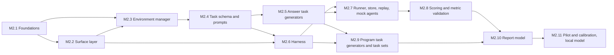

# Wave 2 Roadmap

Status: **Proposed. Pending approval. No milestone below has started.**
Baseline: Wave 1C.16.1, commit `642b2c8`.

Sizes (S, M, L) are the author's relative judgment of effort and are not measurements. No calendar
estimates are given, because none could be justified.

## 1. Ordering principle

1. **Retire the validity risks first.** The surface layer and the environment identity decide whether
   the benchmark means anything. They are built before any task, scoring or model code.
2. **Cheap, checkable tasks before expensive ones.** Answer tasks (a value compared with a verified
   expected value) come before program tasks (a program graded by tests).
3. **Pure functions before orchestration.** The harness is a pure function and is finished before the
   runner that calls it.
4. **Validate the metrics on synthetic agents before any real model.** Real models come last, need
   approval, and run locally at no cost.
5. **Every milestone is one reviewable release** under the repository's release process.

## 2. Decisions needed before M2.1

The following are **gates**, not implementation tasks. M2.1 cannot exit until each has an owner and a
written approval or amendment:

- D-001 task/pair canonical equivalence;
- D-002 task-set identity and split hashing;
- D-003 environment/generator/runtime identity;
- D-004/D-005 scoring unit and bootstrap contract;
- D-006/D-007 D8 and undefined-value rules;
- D-008 runtime status contract;
- D-009 trusted-local versus security-compliant official eligibility;
- D-010 provider and storage amendments;
- D-011 worked-example regeneration;
- D-012 byte-framed derived randomness;
- SD1-SD10 and the additional requirements in `requirements-traceability.md`.

No milestone may label an unmet normative requirement as complete. Requirements needing amendment stay
`PROPOSED_AMENDMENT` until the owner approves the exact before/after text.
## 3. Dependency graph

M2.5 and M2.6 can proceed in parallel after M2.4. M2.8 and M2.9 can proceed in parallel.

## 4. Milestones

### M2.1 Foundations and runtime rulings (S)

* **Objective.** Put the shared primitives and the rulings in place before anything builds on them.
* **Scope.** Strict canonical JSON and SHA-256 helpers in `src.benchmark.canonical`. Module import
  rules test (overview, 3.1). Record approved runtime changes only after the D-008/F1/F3/F5 rulings.
  Define the runtime semantics constant, status migration and conformance corpus only if approved.
  The conformance corpus with its result digest. Golden vectors for the worked examples in the task
  schema, regenerated only after the T7/T8/T9 corrections.
* **Dependencies.** Architecture approval, the requirements traceability decisions, and D-001 through D-010.
* **Deliverables.** The canonical module and tests. The conformance corpus. The import rule test.
  A RELEASES.md entry. Each approved runtime change as its own commit with its own tests.
* **Verification.** Hash vectors reproduce the task schema examples exactly. The strict
  canonicalizer rejects floats, non string keys and unknown types. Any approved behavior change comes
  with a bump of the runtime version and a corpus update, or the suite fails. The full suite exits 0.
* **Exit criteria.** The 1,142 existing tests still pass unchanged apart from the approved changes.
  The golden vectors are committed.
* **Risks.** A runtime ruling is deferred. Then the design stays valid (it works around F1 to F5) but
  keeps the workarounds.

### M2.2 Surface layer (M)

* **Objective.** Build the profile model, tokenizer and translator, and prove them against both
  evaluators.
* **Scope.** Profile types, validation gates E1, E2 and E8, a profile generator driven by hash
  derivation, the translator with mangling, name restoration for text shown to a model.
* **Dependencies.** M2.1.
* **Deliverables.** `src.benchmark.surface` and its tests.
* **Verification.** Round trip (E3) over the corpus. Differential test (E4): random programs written
  canonically, rewritten to surface form and translated back must give the same
  `(status, value, error class)` on the production **and** the reference evaluator, across all arithmetic and boolean
  configurations and both profile kinds. A second tokenizer, written independently inside the test
  suite, must agree with the first on a generated corpus including adversarial inputs (adjacent
  tokens, negative numbers, keyword-like prefixes). Property: translated output contains only
  canonical reserved words and `_u<N>` identifiers. Mutation testing of every gate.
* **Exit criteria.** No disagreement on the differential corpus. Every mutant of the gates is caught
  or reported as equivalent.
* **Risks.** A translator defect would affect both evaluators identically and would not be caught by
  comparing them with each other. That is why the second tokenizer exists and why the corpus is
  checked against the canonical result rather than evaluator against evaluator.

### M2.3 Environment manager (M)

* **Objective.** Derive, validate, freeze and store environments with reproducible identities.
* **Scope.** Environment record and identity, hash derivation (no `random`), pinned inert seed fields,
  generator family/algorithm version, observable fingerprint, runtime semantics version, validation
  gates E1 to E8, lifecycle, store of immutable records, and task-set identity including split
  assignments and complete blueprint content.
* **Dependencies.** M2.1, M2.2.
* **Deliverables.** `src.benchmark.environments` and tests.
* **Verification.** Identical derivation twice gives identical identifiers. Derivation does not depend
  on `PYTHONHASHSEED` (checked in subprocesses with different values). Two derivations that produce
  the same observable environment get the same identity. A change in arithmetic mode, short circuit
  mode, surface profile or runtime version changes the identity. The fingerprint recomputes from a
  fresh generator. The worked-example identifiers reproduce.
* **Exit criteria.** All gates have negative tests. A property test over many derivations finds no
  identity collision between environments that differ in an observable way.
* **Risks.** The language space is small (6 configurations), so distinct meaning assignments carry
  the variety. The number of distinct environments from the generator must be reported honestly.

### M2.4 Task schema, validators, public view and prompts (M)

* **Objective.** Implement the task and task set records, validation rules T1 to T15 and TS1 to TS4,
  the public view, the language reference and the prompt builder.
* **Scope.** Records, validators, `project_public`, template registry interface, the language
  reference generator with executable claim checks (gate E7), prompt template version 1, the
  leakage lint (T12).
* **Dependencies.** M2.3.
* **Deliverables.** `src.challenge` types and validators. `src.benchmark.prompts`.
* **Verification.** Each rule has a positive and a negative test. A test that edits one field of a
  frozen task and shows that the identifier check fails. The leakage lint is run over built prompts and
  must catch a deliberately planted hidden value. Every documentation sentence template runs its
  check against every environment kind and **fails** against a deliberately wrong environment.
* **Exit criteria.** Hand written versions of the three worked example tasks load, validate and
  reproduce their identifiers.
* **Risks.** Documentation claims are numerous. Writing a check per sentence is slow, but an
  unchecked sentence is the main fairness risk.

### M2.5 Answer task generators: `EVAL`, `SYN`, `INF`, `CTRL` (M)

* **Objective.** Generate value-answer tasks with verified expected results.
* **Scope.** Templates, program generators over the typed core (the existing random program
  generators in the differential tests are prior art), two-source verification (T5), the pair builder
  with gates T7 and T8, identifiability (T13) and non-triviality (T9), chance floor control (T10).
* **Dependencies.** M2.4.
* **Deliverables.** Templates and generators, and unit and property tests.
* **Verification.** For every generated task both evaluators agree. Generation is deterministic from
  the derivation seed. A planted wrong expected value is rejected. A planted non-discriminating pair
  is rejected. A planted non-identifiable `INF` task is rejected. Rejection rates are measured and
  reported, not assumed.
* **Exit criteria.** A blueprint's answer-task slots can be filled for a sample of environments of
  every semantic configuration.
* **Risks.** For some environments no discriminating query exists for a slot (R6). The environment is
  then skipped, which may bias the environment sample. The skipping is reported.

### M2.6 Harness (M)

* **Objective.** The pure `evaluate(task, env, response_text)` function, with all failure categories.
* **Scope.** Extraction rules, form validation, translation, execution through the production
  engine, the pinned message classifier, the comparison, the subprocess watchdog and the submission
  size cap.
* **Dependencies.** M2.2, M2.4.
* **Deliverables.** `src.benchmark.harness` and tests.
* **Verification.** Every category and detail value of the evaluation document, section 3.1, is
  reached by a test. Every row of the message table is reached by a corpus program, and an unknown
  message produces a `harness_fault`. Purity: calling `evaluate` twice, in different orders and
  processes, gives equal results. No submission within the size cap raises an unclassified result (a
  property test with adversarial generators). The watchdog kills a runaway process and reports
  `wall_clock`. The memory limit behavior is **measured on the development platform and
  documented**, not assumed. A static check that the benchmark packages contain no call to `eval`,
  `exec`, `compile`, `pickle` or a shell. If the official security gate is selected, a separate
  Docker/WASM harness must pass the no-network, temporary-filesystem, CPU and memory checks before
  official execution is enabled.
* **Exit criteria.** The strategy agents' attempts (M2.7) will classify as expected.
* **Risks.** Worker process startup cost. A pool of reused workers may be needed, measured in this
  milestone. Platform differences in resource limits.

### M2.7 Runner, store, replay and mock agents (M)

* **Objective.** Run a design end to end and replay it.
* **Scope.** `ModelAdapter` port, scripted adapter, deterministic strategy agents, privileged oracle
  and prior agents, the runner with resume, the store with hash chain and artifacts, replay modes RP1 to RP3.
* **Dependencies.** M2.5, M2.6.
* **Deliverables.** `src.benchmark.ports`, `src.benchmark.store`, `src.benchmark.experiments`,
  `src.models` mocks, and tests.
* **Verification.** The import boundary test for `src.models`. A run interrupted at every attempt
  boundary resumes to identical records. Corrupted, deleted and reordered lines are detected. Replay
  modes pass on a stored run and fail, with a precise report, when a harness change is planted. A
  privileged adapter is refused in official mode.
* **Exit criteria.** A complete run of a small task set, with the mock agents, produces a verifiable
  directory that replays to equal hashed fields.
* **Risks.** File locking behavior differs by platform.

### M2.8 Scoring engine and metric validation (M)

* **Objective.** Implement every metric and aggregation exactly as defined, and show that the metrics
  separate known behaviors.
* **Scope.** P1 to P4, D1 to D12, cluster bootstrap with a derived stream, comparability checks, the
  synthetic agent suite.
* **Dependencies.** M2.7.
* **Deliverables.** `src.benchmark.scoring` and tests.
* **Verification.** Hand computed small examples for every formula (using exact fractions). Every row
  of the synthetic agent table in the evaluation document, section 10, is a test with exact
  expected signatures. Property tests: macro and micro agree under equal slot counts, an agent that
  fails everything has zero paired effects, bootstrap with a fixed stream repeats, and results with
  different comparability keys are refused. A metric that does not separate the agents it should
  separate is **changed**, and the change is recorded.
* **Exit criteria.** All synthetic signatures hold, or a documented design change replaced the metric.
* **Risks.** A metric turns out to be degenerate. This is the purpose of the milestone, and the cost
  is rework in the evaluation document.

### M2.9 Program task generators, blueprint and task sets (L)

* **Objective.** `CONS`, `REC` and `ERR` tasks, the blueprint and the complete task set builder.
* **Scope.** Specification driven generators with closed form oracles where possible, hidden test
  generation with disjointness (T6), oracle envelope control (T11), `ERR` classify and fix forms,
  the task set and split tooling, four-cell factorial groups for the interaction contrast, sealed seed
  commitment and reveal.
* **Dependencies.** M2.5, M2.6.
* **Deliverables.** Generators, blueprint `bp1`, task set builder, sealed seed tooling.
* **Verification.** Reference solutions pass their own tests on both evaluators. Planted wrong
  solutions fail them (mutation style). A hard-coding strategy fails the hidden tests. The
  commitment verifies after reveal and fails if the list changes.
* **Exit criteria.** A task set with dev and held-out splits can be built, validated and frozen.
* **Risks.** Verification of recursive tasks is limited by the reference evaluator's envelope, so
  deep recursion tasks rely on closed forms and production only.

### M2.10 Report model and rendering (S)

* **Objective.** Produce the structured report and a plain Markdown rendering.
* **Scope.** Report builder, schema, comparability enforcement, Markdown renderer. No frontend, no
  server.
* **Dependencies.** M2.8, M2.9.
* **Deliverables.** `src.benchmark.reporting`, tests, a sample report built from a synthetic run.
* **Verification.** A report is a pure function of its records. The rendered values match
  the integer pairs. Refusal on mismatched comparability keys. Incomplete runs have no headline.
* **Exit criteria.** The report model is stable enough that a future interface could be built against it.
* **Risks.** Over-design of fields that no consumer needs yet.

### M2.11 Pilot and calibration with a local model (M, requires explicit approval)

* **Objective.** First contact with real behavior, at zero cost, to calibrate what cannot be known in
  advance.
* **Scope.** A local Ollama adapter on the same machine, with no key. An OpenAI-compatible transport
  is later and optional. A pilot on the dev split only. Calibration of difficulty mapping, size caps, the number of environments (power
  analysis, R7), prompt template alternatives (R8), and the surface name distribution (R9 checks).
* **Dependencies.** M2.10, and **approval** to use a local model and to install one.
* **Deliverables.** The adapter, a pilot report, calibrated parameters, and an updated list of open
  questions.
* **Verification.** The pilot is replayable (RP1). Adapter import boundary holds. No secret is stored.
  All claims in the pilot report are labelled with their sample size and uncertainty.
* **Exit criteria.** Parameters are set from data and recorded, or an explicit decision to keep a
  placeholder and why. No claim of general ability is made.
* **Risks.** Floor effects with small local models (R2). Time per attempt on local hardware is
  unknown until measured. The held-out split is **not** touched in a pilot.

## 5. Release process for every milestone

The repository's release process applies to each milestone: inspect `git status`, review the exact
changed files, run the relevant tests and the full suite and record the real exit codes, mutation
test new validation logic, review the whole diff, stage explicit paths only, commit with a
milestone message, push normally, and check that local `main` equals `origin/main`.
`.kiro/specs/unknownlang/tasks.md` is never touched without authorization.

## 6. What Wave 2 deliberately does not contain

An API, a database, a frontend, accounts, deployment, paid services, interactive protocols (R13),
a second language family, and any claim about general reasoning. Each belongs to a later wave and
needs its own decision.
