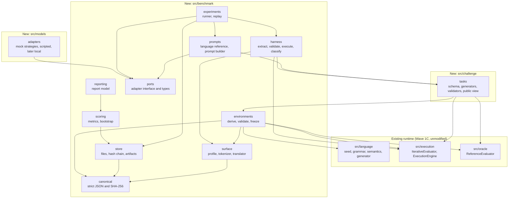
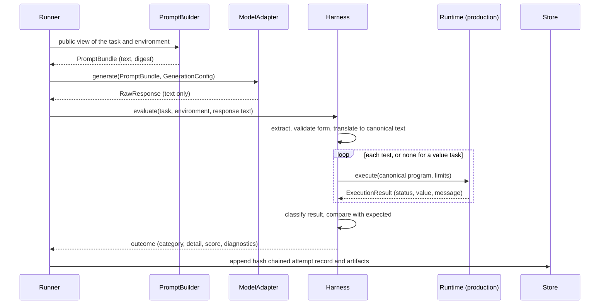
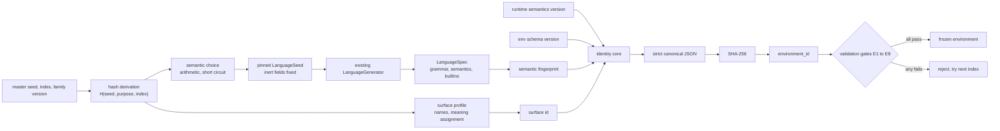

# Wave 2 Architecture Overview: Benchmark Execution Architecture and Design

Status: **Wave 2.1.0 foundation implementation.** F1, surface translation, strict identity helpers,
generator conflict validation and structured diagnostics are implemented. The benchmark harness, task
system, scoring, providers, storage, replay and sandbox remain unimplemented.

| Document | Content |
|---|---|
| this file | goals, architecture, components, data flow, technology, deltas, research design |
| [benchmark-task-schema.md](benchmark-task-schema.md) | environment and task records, identifiers, enumerations, validation rules, worked examples |
| [evaluation-and-scoring.md](evaluation-and-scoring.md) | outcome taxonomy, metrics, aggregation, anti-gaming, reproducibility |
| [experiment-model.md](experiment-model.md) | experiment records, adapter interface, persistence, replay, report model |
| [roadmap-wave2.md](roadmap-wave2.md) | implementation milestones |
| [runtime-findings.md](runtime-findings.md) | defects and gaps found in the existing runtime. **Not fixed. Approval requested.** |
| [adr/](adr) | five decision records |
| [wave2-decisions.md](wave2-decisions.md) | Wave 2.0.2 consolidated decisions D-001 to D-012 |
| [requirements-traceability.md](requirements-traceability.md) | Requirement-by-requirement compliance, deviations, deferrals and proposed amendments |
| [scoring-contract.md](scoring-contract.md) | Normative metric, undefined-value, bootstrap and D8 contract |
| [wave2-owner-approval.md](wave2-owner-approval.md) | Owner decision package; no decisions are marked approved |

## 1. Goals and non-goals

### 1.1 Goals

UnknownLang should measure whether a model can read an unfamiliar, precisely specified programming
language and then use it: infer what unfamiliar operators do, predict programs' results, write
programs, and keep working when the language changes. The architecture must be:

* **Valid**: each measurement can be tied to a controlled manipulation, with the limits of the claim
  stated.
* **Deterministic and reproducible**: environments, tasks and evaluation are pure functions of
  recorded inputs.
* **Independently checkable**: every expected answer is confirmed by a second source.
* **Affordable**: Python standard library plus the existing Lark dependency. No paid service, no
  network requirement. Local-first.
* **Built on the Wave 1C runtime**, which stays unmodified.

### 1.2 Non-goals

* No claim that the benchmark measures general intelligence or proves reasoning. It measures
  behavior inside one small, specified language family under controlled manipulations
  (evaluation document, section 7.4).
* No process level security sandbox. The runtime is not one (section 8).
* No FastAPI service, database, frontend, background workers, authentication, user accounts or cloud
  deployment in Wave 2.
* No change to the frozen grammar or to evaluator semantics. Where the runtime has a defect, it is
  reported in [runtime-findings.md](runtime-findings.md) and **not** fixed here.
* No model integration is implemented in this milestone. The first adapters are deterministic mocks.
* No fabricated results. This wave contains no experiment on any real model.

## 2. What the baseline can and cannot vary

The brief calls the languages procedurally generated. The audit of the actual code (run read only on
the Wave 1C.16.1 tree; details in [runtime findings](runtime-findings.md)) shows how much variation
exists today.

| Question | Measured answer |
|---|---|
| Does the grammar depend on the seed? | No. `GrammarBuilder` produces the same grammar for every seed. Only `lisp` generates a grammar |
| Which seed fields change behavior? | Only `arithmetic` (3 values) and `short_circuit` (2 values) |
| How many distinct languages exist? | **6.** Across 36 seeds that varied name, features, difficulty, arithmetic and short circuit, there were 36 `language_id` values but only 6 distinct grammar-and-semantics fingerprints |
| Are the operator names variable? | No. The ten operations are `add sub mul div mod and or not eq if`, always with these names |
| Is `language_id` tied to runtime behavior? | No. It hashes the seed and two caller supplied version strings. It did not change when Waves 1C.15 and 1C.16 changed behavior |

Consequence: with the runtime as it is, the benchmark would present a model with the same
familiar-looking Lisp in six semantic flavors. That cannot test adaptation to an *unfamiliar*
language, and a model could succeed by recognizing `add`, `sub` and `if`. This is the central
design problem of Wave 2, and the architecture is built around it.

The solution that needs no change to the grammar or the evaluators is a **surface layer** (section
4, component 1): a deterministic, invertible translation that renames keywords, operators and
boolean literals and can permute the meaning of operators of the same type. It multiplies the
language space, makes names unfamiliar, and lets familiar names carry misleading meanings, all
**before** the unmodified runtime executes the program.

This is a design decision with a cost. It adds a new component whose bugs affect both evaluators,
and it widens the specification (delta SD6). The alternative of changing the grammar is excluded by
the frozen-grammar rule and would restart Wave 1. See [ADR-001](adr/ADR-001-environment-identity.md).

The resulting family is still small: ten operations, integers and booleans, first-order functions
with recursion, 6 semantic configurations, and surface re-skinning. The benchmark must say so
wherever results are reported.

## 3. System architecture



An arrow `A --> B` means "A uses B". The graph is acyclic (section 11 checks this mechanically).
Two properties matter most:

* **The runtime depends on nothing in the benchmark.** The benchmark is a client of the frozen
  runtime. The existing independence rule for the reference evaluator is unchanged.
* **Adapters depend only on `ports`.** An adapter cannot reach the harness, the tasks, the
  environments or the runtime. The runner receives adapters by injection.

### 3.1 Module dependency rules

This table is the authoritative statement of allowed imports. A test (milestone M2.1) parses the
imports of every module and fails if any module imports something not listed here. The table is also
used by the documentation check in section 11.

| Module | May import |
|---|---|
| `src.language` | existing, unchanged |
| `src.execution` | `src.language` |
| `src.oracle` | `src.language`, `src.execution.types` |
| `src.benchmark.canonical` | standard library |
| `src.benchmark.ports` | standard library |
| `src.benchmark.surface` | `src.benchmark.canonical` |
| `src.benchmark.store` | `src.benchmark.canonical` |
| `src.benchmark.environments` | `src.language`, `src.execution`, `src.oracle`, `src.benchmark.surface`, `src.benchmark.canonical` |
| `src.challenge` | `src.benchmark.environments`, `src.execution`, `src.oracle` |
| `src.benchmark.prompts` | `src.challenge`, `src.benchmark.ports` |
| `src.benchmark.harness` | `src.benchmark.surface`, `src.execution`, `src.challenge` |
| `src.benchmark.experiments` | `src.benchmark.harness`, `src.benchmark.prompts`, `src.benchmark.ports`, `src.benchmark.store` |
| `src.benchmark.scoring` | `src.benchmark.store` |
| `src.benchmark.reporting` | `src.benchmark.scoring` |
| `src.models` | `src.benchmark.ports` |

`src.benchmark`, `src.challenge` and `src.models` already exist as empty placeholder packages, so
the layout needs no new top level directory. The harness uses only the **production** evaluator for
candidate programs. The reference evaluator is used where expected answers and environments are
built and validated, never in the scoring path of a model response (section 8.2).

## 4. Component responsibilities

| # | Component | Responsibility | Inputs | Outputs | Must not |
|---|---|---|---|---|---|
| 1 | **Surface layer** | Define surface profiles. Tokenize surface text. Translate to canonical text with identifier mangling. Restore names in text shown to a model | surface text, profile | canonical text, name map | run a program, import an evaluator, change meaning other than through the profile |
| 2 | **Environment manager** (brief A) | Derive environments from seeds by hashing. Build the `LanguageSpec` through the existing generator. Compute identities. Run validation gates. Manage lifecycle | master seed, index, family version | frozen `EnvironmentRecord` | modify the generator or runtime, use `random` |
| 3 | **Task system** (brief B) | Define the task schema. Generate tasks from templates. Verify expected answers with two sources. Enforce validation rules T1 to T15. Build the public view. Build task sets and blueprints | environment, template, derivation seed | validated `Task`, `TaskSet`, `PublicTask` | expose private fields to anything but the harness and scoring |
| 4 | **Prompt builder** | Render the language reference and prompt text from the public view. Pair documentation claims with executable checks | public task, environment | `PromptBundle` | read private fields, vary wording without a version bump |
| 5 | **Harness** (brief C) | Extract an answer, validate form, translate, execute through the production engine with limits, classify the result, compare with `expected`. A **pure function** of its inputs | task, environment, response text | attempt outcome | call a model, write storage, use `eval` or `exec`, execute anything but UnknownLang |
| 6 | **Scoring engine** (brief D) | Compute metrics and uncertainty from stored records | attempt records | score tables | read tasks' private fields or call a runtime |
| 7 | **Experiment runner, store and replay** (brief E) | Schedule attempts, call adapters, build and chain records, persist, resume, replay | experiment design, adapter | run directory | score, change a record after writing |
| 8 | **Model adapters** (brief F) | Turn prompt text into response text | `PromptBundle` | `RawResponse` | see tasks or answers, write records, import anything but the standard library and `ports` |
| 9 | **Reporting** (brief G) | Build the structured report model from scores and manifest | score tables | `report.json` | compute a metric of its own |

Every row names its inputs and outputs, and each output feeds exactly one downstream component, which
is the dependency graph in section 3.

## 5. Data flow

### 5.1 One attempt



`H` is a pure function. Given the same task, environment and response text it returns the same
outcome. This is what makes evaluation replayable without calling the model again.

### 5.2 Environment generation and identity



The identity covers what a model can observe. It excludes the seed, the derivation path and the
inert seed fields, so two derivations that produce the same environment get the same identifier.

## 6. Major interfaces

Design only. Signatures are illustrative and fix responsibilities, not names.

```python
# surface
def to_canonical(surface_text: str, profile: SurfaceProfile) -> Translation: ...
def restore_names(text: str, name_map: NameMap) -> str: ...

# environments
class EnvironmentManager:
    def derive(self, master_seed: str, index: int, family_version: str) -> EnvironmentRecord: ...
    def validate(self, env: EnvironmentRecord) -> list[GateResult]: ...
    def freeze(self, env: EnvironmentRecord) -> EnvironmentRecord: ...

# tasks (src.challenge)
class TaskTemplate(Protocol):
    id: str
    version: int
    def generate(self, env: EnvironmentRecord, derivation: Derivation) -> Task | Rejection: ...
def validate_task(task: Task, env: EnvironmentRecord) -> list[RuleResult]: ...
def project_public(task: Task) -> PublicTask: ...

# prompts
class PromptBuilder:
    def build(self, public: PublicTask, env: EnvironmentRecord) -> PromptBundle: ...

# harness: a pure function
def evaluate(task: Task, env: EnvironmentRecord, response_text: str) -> AttemptOutcome: ...

# experiments
class Runner:
    def run(self, design: ExperimentDesign, adapter: ModelAdapter, store: Store) -> RunManifest: ...
def replay(run_dir: Path, mode: ReplayMode) -> ReplayReport: ...

# scoring
def score(records: Iterable[AttemptRecord], task_set: TaskSet) -> ScoreTable: ...
```

The adapter interface is in [experiment-model.md](experiment-model.md), section 5. The report model is
in experiment-model.md, section 10.

## 7. Technology decisions

| Concern | Decision | Reasoning | Revisit when |
|---|---|---|---|
| Language | Python, the version verified in this audit (3.14.6) | The runtime is Python. See finding F3 on 3.11 to 3.13 | F3 is resolved and a second version is tested |
| Parser and runtime | Existing Lark grammar and evaluators, unchanged | They are the product of Wave 1C and have 1,142 tests | never for Wave 2 |
| Dependencies | Standard library plus Lark. Hand written validators in the style of `seed.py`. No `jsonschema`, no `pydantic` | Minimal dependencies, no cost | a validation need that hand written code cannot meet |
| Database | **No.** Files, with a hash chain ([ADR-004](adr/ADR-004-experiment-storage.md)) | Expected data is thousands to hundreds of thousands of small records. The dataset is append only. A database adds migrations and a server for no scientific gain | more than about a million attempts, concurrent writers, or a query UI. Then a **derived, disposable** SQLite index built from the files |
| FastAPI | **No** in Wave 2 | There is no client. Reports are files | a frontend exists |
| Background workers, queues | **No.** One process runs attempts in order. `ProcessPoolExecutor` from the standard library can parallelize CPU bound evaluation later | A job queue solves a problem that does not exist yet | evaluation time becomes the bottleneck on measured data |
| Caching | None initially. A cache keyed by `(environment_id, program digest, limits, runtime_semantics_version)` would be exact, because evaluation is deterministic | YAGNI | measured need |
| Web frontend | **No.** A report model first, and a Markdown rendering of it | The brief forbids frontend work now | the report model is stable |
| Execution isolation | Subprocess with a wall clock watchdog (section 8) | Bounded, free, standard library | hostile users are ever allowed to submit |
| Existing but unused dependencies | `fastapi`, `uvicorn`, `httpx` are listed in `pyproject.toml` and imported nowhere. Left untouched | Removing them is outside scope (finding F11) | a dependency cleanup milestone |

Wave 2 introduces no new third party dependency.

## 8. Execution and security posture

### 8.1 What is executed

Model output is **text**. By design the harness never executes it as Python: it passes a translated
program only to the UnknownLang runtime, which interprets it with the fixed evaluator. By inspection of the
ten built-ins, the language has no input, output, file, network, string or collection operations (they are
arithmetic, boolean and conditional operations), so a program cannot reach the host through the
language itself. No benchmark code exists yet. The design **requires** that none of it calls `eval`,
`exec`, `compile`, `subprocess` on model text, `pickle`, or a dynamic import, and milestone M2.6
adds a static check that fails the test suite if it does.

### 8.2 Which evaluator runs where

| Use | Evaluator | Why |
|---|---|---|
| Candidate submissions | production only | The reference evaluator uses Python recursion. It was measured at about 75 nested calls, and the language allows 100. It has no resource-limit parity. It cannot run arbitrary candidates |
| Building expected answers and hidden tests | production **and** reference, plus a closed form where one exists | Requirement 8 requires two independent sources. Tasks stay inside the reference envelope (rule T11) |
| Environment validation (gate E4) and the conformance corpus | both | Detects translator and runtime drift |

### 8.3 Residual risks, stated honestly

This is **not** a process level sandbox. requirements.md, Requirement 15, criterion 1 asks that all
execution happen in Docker or WASM. Wave 2 does not provide that (delta SD3). The remaining risks:

1. **Resource exhaustion in the parser.** Step, depth and call limits apply during evaluation, not
   parsing. Parse time was measured on the development machine as about linear: 10 KB in 0.27 s,
   40 KB in 1.14 s, 160 KB in 5.15 s. Controls: a submission byte cap checked before parsing, and a
   wall clock watchdog.
2. **A bug in Lark or Python** reachable by crafted text. Mitigated only by the watchdog and by running
   on a trusted local machine.
3. **Memory.** A per process memory limit is best effort and is not reliable on every platform. It
   must be checked on the development platform in M2.6 before anyone relies on it.
4. **Harness faults from unexpected exceptions.** An unclassified result is a `harness_fault`, which
   makes a run incomplete (evaluation document, section 3). M2.6 must show that no submission within
   the size cap can raise one.

The watchdog is a trusted-local backstop, not a security sandbox. A security-compliant official or
untrusted run is **blocked** until Docker/WASM isolation satisfies requirements.md Requirements 15 and
20.10. Trusted development and explicitly labelled trusted-local pilots may use the watchdog only under
the eligibility rules in [wave2-decisions.md](wave2-decisions.md), D-009.

## 9. Specification deltas

Wave 2.0 found places where requirements.md or design.md cannot be followed literally, or where the
brief and the specification disagree. None is applied silently. Each needs an explicit decision.

| ID | Source | Conflict | Proposed resolution | Disposition |
|---|---|---|---|---|
| SD1 | Requirement 9.1; design.md Challenge Generator | The MVP runtime cannot express arrays, strings, sorting or search | Use the seven expressible Wave 2 categories only after a formal amendment; otherwise extend the language. See requirements-traceability.md | **PROPOSED_AMENDMENT** |
| SD2 | Requirements 3.5 and 11.2 | Ollama is required as a free local provider while OpenAI-compatible APIs are named first | Mocks first, Ollama first real provider, optional OpenAI-compatible transport. See D-010 | **PROPOSED_AMENDMENT** |
| SD3 | Requirements 15 and 20.10 | Docker/WASM isolation is required; watchdog is not a sandbox | Trusted-local watchdog pilots only; official/untrusted execution is blocked without Docker/WASM | **BLOCKED** |
| SD4 | Requirement 12.5 | SQLite is required for the MVP | Files/hash chain are Wave 2 source of truth; SQLite is a later derived index | **PROPOSED_AMENDMENT** |
| SD5 | Requirement 20.8 | Resource limits must be distinct inconclusive, not failed/incorrect | Exclude from correctness denominators, report separately and require an approved official-run cap | **PROPOSED_AMENDMENT** |
| SD6 | Requirements 4.4 and 5.6 | Surface profiles add controlled variation but do not create new grammars or semantic dimensions | Treat profiles as a benchmark factor and amend the “entirely new languages” claim | **PROPOSED_AMENDMENT** |
| SD7 | Requirement 10.4 | Difficulty-weighted correctness is mandatory | Report weighted score W as required; retain unweighted held-out accuracy separately | **DESIGN + AMENDMENT if headline wording remains** |
| SD8 | Requirement 9.3 | Current proposal permitted too few examples/tests | Enforce 3-5 public examples and 10-20 total program tests; define a separate value-task rule | **PROPOSED_AMENDMENT** |
| SD9 | Requirement 7.6 and design.md status contract | `invalid_program` is required but current runtime returns `error` for parse failures | Adopt D-008 boundary mapping or change runtime; preserve compatibility during migration | **PROPOSED_AMENDMENT / BLOCKED** |
| SD10 | Requirement 11.5 | Entire-response fallback is required | Use last fenced block or entire response for programs; final `ANSWER:` for values | **PROPOSED_AMENDMENT** |

## 10. Research design: what makes UnknownLang meaningful

The risk named in the brief is a benchmark that only checks whether a model can solve simple Lisp
expressions. The design answers it in four ways.

**1. Make the language unfamiliar on purpose, then check that it is.** The surface layer replaces
every operator and keyword name. A permuted meaning on a **familiar** name (`add` that subtracts)
creates a case where the prior is wrong. The two profile kinds are what let a researcher compare
"unfamiliar names" with "familiar names that mislead".

**2. Never compare unmatched numbers.** Every claim is a paired difference on matched tasks that differ
in exactly one declared manipulation (task schema, 6.2), with a validity gate that rejects any pair
whose members differ in something else, and a gate that rejects any adaptation task whose answer
does not actually change.

**3. Separate where knowledge comes from.** Five information conditions distinguish reading
documentation from inferring from examples, and `STALE_DOC_EXAMPLES` creates the case where
documentation is out of date and the evidence disagrees with it. Examples are always truthful, and a
misleading example is only one that also fits a wrong hypothesis.

**4. Protect against shortcuts.** Held-out environments are sealed. Hidden tests are disjoint. The
chance floor is bounded. Non-trivial answers are enforced. Answers copied from public examples are
rejected by construction. Synthetic agents with known behavior are used to check that the metrics
separate the behaviors they claim to separate ([evaluation document](evaluation-and-scoring.md), section 10),
**before** any real model is run.

### 10.1 What the benchmark cannot distinguish

* Memorization of the **generator family** from genuine adaptation (R4). A model could learn this
  family. Only new families address it.
* Tokenizer effects from unfamiliarity (R9).
* Models' sensitivity to prompt wording, which could exceed every manipulated factor (R8).
* Active learning. Each attempt is a single turn, so a model cannot run experiments in the language
  the way a person learning it would (R13). This is the most significant limitation of the
  single-turn design, and an interactive protocol is the most valuable extension. It is outside
  this wave.

## 11. Design validation

### 11.1 Checklist from the brief

| Check | Where satisfied |
|---|---|
| Every component has a clear responsibility | section 4 |
| Data contracts are internally consistent | one source of truth for names (task schema). Verified by the documentation check below |
| Environment and task identity are reproducible | rules in task schema 1 and 3. The worked examples were recomputed from those rules |
| Expected results can be independently validated | rule T5, two independent sources, disagreement makes a task `INVALID` |
| Model adapters cannot bypass evaluation | experiment model 5.4 and the import boundary |
| Scoring cannot accidentally reward invalid submissions | evaluation document, principle 1 and section 2 |
| Aggregate metrics are mathematically defined | evaluation document, sections 5 and 6 |
| Failure cases are represented | evaluation document, section 3 |
| No circular dependencies | section 3.1, checked mechanically below |
| No paid infrastructure | section 7: standard library plus Lark, local files, no service |

### 11.2 Validation performed in Wave 2.0

**What was executed.** All probe and check scripts were throwaway. None is committed.

| Activity | Result |
|---|---|
| Pre-flight | `main`, `origin/main` and the remote all at `642b2c8`. Only `.kiro/specs/unknownlang/tasks.md` was modified, which matches the accepted baseline |
| Runtime audit | Read only probes of variation across seeds, keyword-prefix parsing, definition-last programs, program structure quirks, error message families, parse time scaling, and `canonical.py` on Python 3.11 to 3.14. Results are in [runtime-findings.md](runtime-findings.md) |
| Worked examples | Two environments and three tasks built from the real runtime. Every expected result was produced by the production engine **and** the reference evaluator, which agreed in every case. Identifiers were computed with the stated hashing rules |
| Documentation checks | 109 automated checks, all passing: fences, links, table shapes, JSON validity, recomputation of every identifier in the worked examples, re-execution of every embedded result on both evaluators against the live runtime, enumeration consistency, cross-reference resolution, section references, an acyclicity check of the module dependency table, equality of diagram 1 with that table, equality of the roadmap diagram with the milestone dependency lines, topic to milestone consistency, and vocabulary |
| Check of the checks | 21 defects were planted one at a time into a scratch copy (wrong expected value, unknown failure category, broken link, dependency cycle, missing table cell, unbalanced fence, bad section reference, wrong milestone, nonexistent stage, undefined gate and decision identifiers, tampered identifier, dropped diagram edges, and each of the five review corrections reverted). All 21 were caught and the unmodified control passed |
| Independent review | A reviewer in a fresh context read the documents against the brief and returned **FAIL with five findings**: gate T8 contradicted renaming pairs, the bootstrap was undefined for pairs, P3 could be ranked in a degenerate way, D8 was defined two ways, and the guessing control overclaimed. All five were real and were corrected in one pass, each with a targeted check. **The corrected text was not reviewed a second time** |
| Mermaid | All 7 diagrams parse with the Mermaid 12.3.0 parser under Node v24.10.0. The same script rejects a deliberately broken diagram. This validates syntax. The diagrams were not rendered to images |
| Repository suite | 1,142 passed, exit code 0. No file under `src` or `tests` was changed |

**What the checks found in the documents.** The first version of the checker missed 2 of 9 planted
defects, and strengthening it exposed real errors that were then fixed: seven cross-references to the
wrong milestone (left over from renumbering the roadmap), and two pairs of identifier series that
shared a numbering. Task set rules and pipeline stages used the same letter and numbers, and so did
environment gates and engineering decisions. A third collision, replay modes against research
questions, was found by manual review and not by the checker, which then received a check for it.
The series now use distinct prefixes: `TS`, `S`, `E`, `ED`, `RP` and `R`.

**What was not validated.**

* **No implementation exists.** Only throwaway prototypes of the translator and the hashing were
  written, to build and check the worked examples.
* **The metrics are unvalidated.** No real model was run, difficulty levels and blueprint slot counts
  are proposals, and the timings come from one machine.
* **One environment.** Python 3.14.6 and Lark 1.3.1 only. Behavior on other versions is untested
  (see finding F3).
* **The diagrams were parsed, not viewed.**
* **Mechanical checks cannot judge meaning.** They confirm that names, numbers and references are
  consistent. They cannot confirm that a design choice is good. The unresolved questions in section 12
  are where that judgment is still needed.

**Wave 2.0.2 closure validation.** The closure documents add 3 new architecture artifacts and align the
existing schema, scoring, experiment, roadmap, findings, overview and ADR documents. The current
throwaway checker passes 125 checks, including task-set identity, pair equivalence, decision-register
coverage, all metric-contract references, and the five prior review corrections. The 21 planted-defect
checker still catches all 21 defects with an unmodified control. All 7 Mermaid diagrams parse and the
repository suite remains 1,142 passed. This validates consistency, not implementation or scientific
construct validity.

## 12. Unresolved questions

### 12.1 Research questions

These need data or argument, not engineering.

| ID | Question |
|---|---|
| R1 | Does surface re-skinning plus operator permutation plus six configurations make a language unfamiliar enough to require adaptation, or can a model solve it by reading a short table? |
| R2 | Are tasks hard enough for strong models and easy enough for small local models (ceiling and floor effects)? |
| R3 | Do the seven categories measure distinct abilities? Small numbers of free local models make this hard to show |
| R4 | How much does the public generator family contaminate the benchmark, and when must a new family be created? |
| R5 | Do `FULL_DOC` and `EXAMPLES_ONLY` separate reading from inference cleanly? |
| R6 | Are tasks equally difficult across the six semantic configurations? A balanced blueprint does not guarantee it |
| R7 | How many environments are needed to detect an effect of a given size? Answered by a power analysis on pilot data |
| R8 | How much do results depend on prompt wording? |
| R9 | How much of a renaming cost is tokenizer effect and not unfamiliarity? |
| R10 | Are permuted familiar names a fair test of adaptation, or only a test of obeying documentation over habit? |
| R11 | Should error answers use class names, or messages resembling the runtime's? This affects `EVAL` and `ERR` |
| R12 | How would people perform? A small human baseline would greatly strengthen validity claims. It is not budgeted |
| R13 | Would an interactive protocol (a model may run a bounded number of experiments in the language) measure learning better than a single prompt? |

### 12.2 Engineering decisions

These are the original Wave 2.0 engineering decisions. Wave 2.0.2 decisions D-001 through D-011 in
[wave2-decisions.md](wave2-decisions.md) supersede them where they differ.

| ID | Decision |
|---|---|
| ED1 | A strict canonical JSON wrapper: no floats, no `str()` fallback |
| ED2 | Hash derived randomness, not `random` ([ADR-001](adr/ADR-001-environment-identity.md)) |
| ED3 | Files and a hash chain, no database ([ADR-004](adr/ADR-004-experiment-storage.md)) |
| ED4 | A wall clock watchdog in a subprocess |
| ED5 | The last candidate wins in extraction |
| ED6 | Error classification by a pinned message table, and an unknown message is a loud `harness_fault` |
| ED7 | Packages in the three existing placeholder directories |
| ED8 | A `runtime_semantics_version` integer, proposed in M2.1 and needing approval (F4) |
| ED9 | A submission byte cap checked before parsing, value calibrated in M2.11 |
| ED10 | Oracle verified tasks stay at call depth 40 or less |
| ED11 | No new third party dependency |
| ED12 | Integers only in hashed content, ratios as integer pairs |

## 13. Decision records

| ADR | Decision |
|---|---|
| [ADR-001](adr/ADR-001-environment-identity.md) | Environment identity and the surface layer |
| [ADR-002](adr/ADR-002-task-representation.md) | Content addressed, versioned task representation with a public/private split |
| [ADR-003](adr/ADR-003-evaluation-methodology.md) | Binary primary score, paired controlled comparisons, cluster bootstrap |
| [ADR-004](adr/ADR-004-experiment-storage.md) | Append only files with a hash chain, no database |
| [ADR-005](adr/ADR-005-model-adapter-abstraction.md) | A narrow text-in text-out adapter port, mock first |
